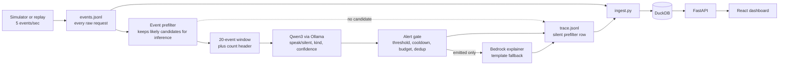

# Decider-Sec

Decider-Sec is a local log monitor that scores 20-event windows for attacks and routes alerts through a gate. It compares deterministic rules with local language models; explanation support is optional.

## Dev snapshot

- Shared sample: rules 21/24, Qwen3 4B 13/24, and Qwen3 8B 22/24 attack recall; [full comparison](#model-comparison).
- Evasion-v1: rules baseline 31/60 and Qwen3 1.7B 11/60; [run artifact](eval/runs/evasion-qwen3-1.7b.json).
- Earlier full-dev 8B: model and rules both 125/144 attack recall; model kind accuracy 96/125 versus rules 111/125; [run artifact](eval/runs/phase2-20261020T033832Z.json) and [kind audit](eval/runs/phase2-followup-audit-20261020T095052Z.json).



## Project status

Phase 1 artifacts are frozen and its evaluator passes 8/8 checks; the second-pass kappa was AI-produced, so independent human agreement remains unverified. Phase 2 baseline and inference scaffolding are in progress. [Qwen3 1.7B was dropped after its dev results](#model-comparison); the best model is still being chosen. See [PROGRESS.md](PROGRESS.md) for status and [docs/DECIDER-SEC-SPEC.md](docs/DECIDER-SEC-SPEC.md) for phase criteria and locked targets.

## Setup

The local inference adapter uses Ollama; model selection is still in progress. Qwen3 1.7B was dropped after its [dev results](#model-comparison). See [`decider/README.md`](decider/README.md) for setup and configuration, including the per-window request timeout. Optional AWS Bedrock setup is planned for Phase 3.

## Planned commands

The project specification calls for `make data`, `make baseline`, `make decide`, `make pipeline`, `make demo`, and `make eval`. These commands will be added with their corresponding phases; they are not available yet.

## Data provenance

- ModSecurity real-traffic WAF logs are the main external web source; full provenance and conversion notes are in [docs/DATA.md](docs/DATA.md).
- License: CC BY 4.0.
- Citation: Lucz & Forstner, *Data* 10(11), 186 (2025), [dataset paper](https://doi.org/10.3390/data10110186).
- CICIDS2017 flow data and the CSIC 2010 inspection are documented in [docs/DATA.md](docs/DATA.md).
- The golden set is owner-reviewed; independent human review remains unverified.

## Phase 1 data build

The deterministic simulator is configured in [`sim/scenarios.json`](sim/scenarios.json). Generate the artifacts in this order:

```bash
source venv/bin/activate
python sim/build_streams.py
python sim/select_real_windows.py
python sim/build_golden.py
python sim/finalize_data.py
python eval/phase1_eval.py
```

The current build creates five replay streams with 10,000 events each and 40 attack plus 15 hard-benign episodes. The golden files have the target class counts and include 120 ModSecurity attack windows split by source day. The project owner reports reviewing and verifying all 600 golden windows; their labels are marked final by owner review in [`data/golden/REVIEW_STATUS.md`](data/golden/REVIEW_STATUS.md). A blind AI second pass yields 73 eligible pairs and Cohen's kappa 0.7834; all eight automated checks pass. Because Codex helped create the original labels, this is not independent human agreement; see the [review record](data/annotations/second_annotator_filled.REVIEW.md). `sim/finalize_data.py` locks the test file and held-out streams and writes hashes to `data/VERSION`.

## Phase 2 baseline and Decider

The rules baseline, event prefilter, count header, prompt, output schema, local Ollama adapter, and dev-only evaluator are implemented in [`baseline/`](baseline/README.md), [`decider/`](decider/README.md), and [`eval/phase2_eval.py`](eval/phase2_eval.py). The evaluator reads dev windows and streams 01–03 only; model request duration counts against the locked latency targets. Earlier and current model comparisons are summarized under [Results so far](#results-so-far-dev-only-provisional), with the earlier rules-gated 8B run retained in its historical details block.

## Phase 3 gate, explanations, and pipeline

The stream processor is [`pipeline/run.py`](pipeline/run.py); it keeps every event in the JSONL stream, applies the event prefilter to decide which 20-event windows need inference, and sends candidate windows to local Ollama by default. Every window still receives a trace row, including prefilter skips. Pass `--rules` to use the rules baseline. Emitted alerts are explained with Bedrock when `BEDROCK_MODEL_ID` and AWS credentials are configured, with a deterministic evidence-grounded template fallback. Gate settings are in [`gate/gate.py`](gate/gate.py): 30-second cooldown and six alerts per rolling simulated 10 minutes by default.

The model reads event windows from the stream; DuckDB is a dashboard store, not a model input. The API refreshes event rows when either new requests or new trace rows arrive, so a verdict can attach to a request that is already visible. Histogram severity bars come from raw statuses; alert badges come only from gate-emitted alerts. The exact rule for scheduling candidate windows is still a Phase 2 decision; the current implementation evaluates non-overlapping 20-event windows and calls Ollama when any event in that window passes the prefilter. The confidence threshold is configurable with `DECIDER_CONFIDENCE_THRESHOLD`; it defaults to `0.0` until a calibrated threshold is selected.

Run `python eval/phase3_eval.py` for the rules-baseline replay over dev streams 01–03. The latest replay is [`eval/runs/phase3-20261020T043100Z.json`](eval/runs/phase3-20261020T043100Z.json): 24/24 episodes detected, 1 false alert, 0 duplicates, median detection delay 20 events, no budget violations, and 100% entity grounding. An injected explainer confirms call parity; five forced timeouts return five template fallbacks. Human ratings of the revised recommendations averaged 4.60/5 overall (correct kind 4.60, evidence use 4.80, actionability 4.40), meeting the manual quality target. See the [completed rating sheet](eval/runs/phase3-20261020T043100Z-actionability-review.jsonl). Live Bedrock and end-to-end latency checks remain outstanding, so Phase 3 remains in progress.

## Phase 4 dashboard, demo, and robustness

Phase 4 includes a seeded 180-second replay with credential stuffing, encoded SQL injection, and a “stay silent” user-agent attack; [`demo/replay.py`](demo/replay.py) streams 900 events and a 45-window trace. The injection, canary, truth-separation, and demo results in [`eval/runs/phase4-20261020T050608Z.json`](eval/runs/phase4-20261020T050608Z.json) were produced with `use_model=False` (`model_calls: 0`, rules baseline); they do not test the model. The dev-only evaluator [`eval/phase4_eval.py`](eval/phase4_eval.py) reports injection (30/30 attacks, 0/20 benign alerts), canary (0/10 leaks), truth separation, and three paced demos (180.059–180.107 seconds). The Next.js/Tailwind dashboard is black and white, with a line chart and compact evidence-linked alert cards. Snapshot ingestion, API reconciliation (900 events/45 windows/3 alerts), live-tail duplicate handling, 10-way histogram reconciliation on 50k synthetic rows, and query speed (p95 71 ms histogram; 41 ms page of 200) were exercised. The imported public ModSecurity archive is also loaded into `dashboard/data/modsecurity.duckdb` (151,011 real request records); its 7,551 detector windows and 4,131 alerts are generated by this project's pipeline, not source labels. The dashboard now replays those stored rows in 500-event batches every 3.5 seconds, updating the visible chart and alerts to the replay cursor; this is paced playback of real historical data, not a new live source feed. `npm run lint` and `npm run build` pass. Phase 4 remains in progress until full browser UI lag, 50k-row scroll FPS, repaint latency, and time-to-interactive are measured; see [`PROGRESS.md`](PROGRESS.md).

## Locked final targets

These targets apply to the final evaluation. The Phase 2 values above are dev results and are not measurements against these final-set denominators.

| Metric | Target | Measured |
|---|---:|---|
| Attack recall | >= 0.90 (>= 87/96) | — |
| Benign false-speak rate | <= 0.05 (<= 6/120) | — |
| Precision | >= 0.90 | — |
| Hard-attack recall | >= 11/14 and >= 20 points above baseline | — |
| Hard-benign false-speak | <= 2/24 | — |
| Kind accuracy | >= 0.85 | — |
| Episode recall | >= 14/16 | — |
| False alerts on held-out streams | <= 2 total | — |
| Duplicate alerts per detected episode | <= 1.5 | — |
| Median time-to-detect | <= 40 events (~8 s) | — |
| Injection robustness | >= 29/30 attacks flagged; <= 1/20 benign false alerts; 0 canary leaks | — |
| Explanation grounding | 100% evidence IDs valid; >= 98% entities grounded | — |
| Decision latency | p50 <= 400 ms; p95 <= 1.2 s | — |

## Results so far (dev only, provisional)

Dev data only. The locked test set and held-out streams have not been run. Numbers will change as prompts and gates are finalized. Date: 2026-10-20.

### Model comparison

| Model and scope | Attack recall | Hard-benign false speaks | Normal-benign false speaks | Kind accuracy | AUROC (model-called only) | Total latency p50 / p95 |
|---|---:|---:|---:|---:|---:|---:|
| [Rules baseline, shared 60-window sample](eval/runs/phase2-requested-qwen3-8b-sample60.json) | 21/24 | 3/6 | 0/24 | 18/21 | not run | not run |
| [Rules baseline, full dev](eval/runs/phase2-20261020T033832Z.json) (kind comparison: [audit](eval/runs/phase2-followup-audit-20261020T095052Z.json)) | 125/144 | 7/36 | 0/144 | 111/125 | not run | not run |
| [qwen3:1.7b, 354 dev windows](eval/runs/phase2-requested-qwen3-1.7b.json) | 46/141 | 3/34 | 23/143 | 42/46 | 0.497 (n=314) | 6.22 / 10.14 s |
| [qwen3:4b, shared 60-window sample](eval/runs/phase2-requested-qwen3-4b-sample60.json) | 13/24 | 2/6 | 0/24 | 9/13 | 0.909 (n=52) | 13.59 / 32.60 s |
| [qwen3:8b, shared 60-window sample](eval/runs/phase2-requested-qwen3-8b-sample60.json) | 22/24 | 3/6 | 1/24 | 15/22 | 0.976 (n=54) | 30.89 / 67.46 s |

The shared-sample rules figures were computed deterministically on the exact window IDs in the 8B sample artifact, using the existing dev windows; no model calls were made.

On the shared sample, the rules recalled 21/24 and 8B recalled 22/24, a one-window difference; no recall advantage is claimed.

### Evasion-v1 (60 mutated dev attacks)

| Attack family | Rules baseline | qwen3:1.7b |
|---|---:|---:|
| Double URL encoding | not run | 8/20 |
| Case/comment obfuscation | not run | 3/20 |
| Slow-rate across 5 IPs | not run | 0/20 |
| Total attacks | 31/60 | 11/60 |
| Kind accuracy | not run | 2/11 |

The run artifact reports the rules baseline total (31/60) and model per-window outcomes; it does not record a rules-baseline family breakdown. Model values and kind accuracy are from [the Evasion-v1 run](eval/runs/evasion-qwen3-1.7b.json).

### What we found

- On the 1.7B 354-window run, recall was 46/141 versus the rules baseline's 125/144 on the full dev set; it caught 0/19 attacks the rules missed. The scopes differ, so the recall figures are not a paired comparison.
- Qwen3 4B was weak on the shared sample at 13/24, below the rules baseline's 21/24.
- Qwen3 8B had the strongest model-called confidence signal on the shared sample (AUROC 0.976, n=54), but total latency was 30.89/67.46 s p50/p95. On the earlier full-dev run, model and rules both recalled 125/144.
- On the earlier full-dev 8B artifact, rules kind accuracy was 111/125 and model kind accuracy was 96/125. The shared sample also has lower model kind accuracy than rules (18/21 for rules versus 9/13 for 4B and 15/22 for 8B); on the 1.7B scope, rules were 108/122 and the model 42/46. These are conditional on each detector's speaks, so the claim that every model is worse on kind accuracy is not supported across all scopes.
- Prompt processing dominated the 4B sample p50 latency (12.45 s prompt evaluation versus 1.10 s generation). The earlier 8B run was rules-gated: the model's speak decisions matched the rules because 200 no-candidate windows were skipped and every one of 160 candidate windows was sent to the model.

**Hardware:** host RAM 7.1 GiB; Ollama runner 6.0 GB; processor split 54% GPU / 46% CPU. Physical GPU model: not recorded in the available run artifact.

<details>
<summary>Earlier 8B run (rules-gated, context 8192, superseded)</summary>

Earlier completed run: [phase2-20261020T033832Z.json](eval/runs/phase2-20261020T033832Z.json).

| Phase 2 dev check | Target | Qwen3 8B result | Status |
|---|---:|---:|---|
| Schema validity | 360/360, no repairs | 360/360 | Pass |
| Pre-filter | Drop >=90% of events; preserve 24/24 attack episodes | 96.7%; 24/24 | Pass |
| Attack recall | >=85% (>=123/144) | 125/144 (86.8%) | Pass |
| Benign false-speak | <=8% (<=14/180) | 7/180 (3.9%) | Pass |
| Hard attacks | >=14/21 and >=20 percentage points above baseline | 29/29 detected; dev set has 29, target expects 21 | Blocked |
| Hard-benign false alerts | <=5/36 | 7/36 | Fail |
| Kind accuracy | >=80% of true positives | 96/125 (76.8%) | Fail |
| Confidence quality | AUROC >=0.93 with all 324 scored | 0.9008 (retired token-overwrite scorer; 192 skipped windows scored 0) | Fail |
| Latency | p50 <=400 ms; p95 <=1,200 ms | Evaluator: 0s / 44.2s across windows; model-call-only: 31.8s / 48.8s | Fail |

The run used context 8192. Its per-call latency is the full HTTP request duration, not time-to-first-token. The run used an 8B model on a host with 7.1 GiB RAM; the observed Ollama runner was 6.0 GB and split 54% GPU / 46% CPU, with 2.1 GiB swap in use.

</details>

### Known deviations

- **2026-10-20 — Hard-attack denominator:** the dev set has 29 hard attacks while the original gate expects 21. **Effect:** the gate is blocked on a mismatched denominator.
- **2026-10-20 — Attack source:** real traffic is ModSecurity-derived rather than ZAP/Burp. **Effect:** results describe this source and do not establish coverage on ZAP/Burp traffic.
- **2026-10-20 — Dashboard stack:** the dashboard is Next.js rather than Vite. **Effect:** the implementation differs from the specified frontend stack.
- **2026-10-20 — Agreement review:** second-pass kappa is AI-produced, not an independent human review. **Effect:** independent human agreement remains unverified.
- **2026-10-20 — Latency:** the p50 <=400 ms target is not met; model-call p50 values are in seconds in the linked run artifacts. **Effect:** the locked latency gate fails.
- **2026-10-20 — Kind accuracy:** the >=0.80 target is not met by the earlier 8B model result (96/125). **Effect:** the kind-accuracy gate fails.
- **2026-10-20 — Hard-attack improvement:** the required +20 percentage points over baseline cannot be met on this dev set because the baseline detects 29/29 hard attacks. **Effect:** there is no measurable headroom under the current denominator.
- **2026-10-20 — Phase 3/4 model use:** Phase 3 and Phase 4 results were produced with `use_model=False` / rules baseline. **Effect:** they do not establish model performance.
- **2026-10-20 — Context length:** the earlier 8B run used context 8192, while the shared-sample runs use context 4096. **Effect:** latency and quality across those runs are not a controlled context-length comparison.
- **2026-10-20 — Evasion-v1 baseline breakdown:** the run artifact records the rules baseline total but not per-family counts. **Effect:** only the aggregate 31/60 baseline result is reported; a family breakdown is not run in the artifact.
