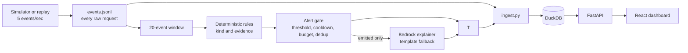

# Decider-Sec

Decider-Sec is a local log monitor that evaluates 20-event windows with deterministic rules. Rules decide and emit alerts. Bedrock can write a grounded explanation when explicitly enabled; a deterministic template is the fallback. Historical Ollama experiments are retained as study code and cannot change alerts.

## Dev snapshot

- Historical local-model comparisons are study results only; see [model comparison](#model-comparison).
- Current rules results and evasion-v1-v3 results are in [Results so far](#results-so-far-dev-only-provisional); v4 will be scored only after its freeze commit.



## Project status

Phase 1 artifacts are frozen and its evaluator passes 8/8 checks; the second-pass kappa was AI-produced, so independent human agreement remains unverified. The current alert path is rules-first; local Qwen results remain historical study artifacts. See [PROGRESS.md](PROGRESS.md) and [docs/DECIDER-SEC-SPEC.md](docs/DECIDER-SEC-SPEC.md) for status and phase criteria.

## Setup

The production pipeline does not use Ollama. Bedrock explanations are opt-in and require working AWS credentials; template explanations are used otherwise. See [`decider/README.md`](decider/README.md) for the local-model study code.

## Planned commands

Use `make rules-dev`, `make phase3`, or `make phase4` for dev-only runs. `make study-phase2` runs the historical local-model experiment. No target runs Phase 5.

## Data provenance

- ModSecurity real-traffic WAF logs are the main external web source; full provenance and conversion notes are in [docs/DATA.md](docs/DATA.md).
- License: CC BY 4.0.
- Citation: Lucz & Forstner, *Data* 10(11), 186 (2025), [dataset paper](https://doi.org/10.3390/data10110186).
- CICIDS2017 flow data and the CSIC 2010 inspection are documented in [docs/DATA.md](docs/DATA.md).
- The golden set is owner-reviewed; independent human review remains unverified.

## Phase 1 data build

The deterministic simulator is configured in [`sim/scenarios.json`](sim/scenarios.json). Generate the artifacts in this order:

```bash
source venv/bin/activate
python sim/build_streams.py
python sim/select_real_windows.py
python sim/build_golden.py
python sim/finalize_data.py
python eval/phase1_eval.py
```

The current build creates five replay streams with 10,000 events each and 40 attack plus 15 hard-benign episodes. The golden files have the target class counts and include 120 ModSecurity attack windows split by source day. The project owner reports reviewing and verifying all 600 golden windows; their labels are marked final by owner review in [`data/golden/REVIEW_STATUS.md`](data/golden/REVIEW_STATUS.md). A blind AI second pass yields 73 eligible pairs and Cohen's kappa 0.7834; all eight automated checks pass. Because Codex helped create the original labels, this is not independent human agreement; see the [review record](data/annotations/second_annotator_filled.REVIEW.md). `sim/finalize_data.py` locks the test file and held-out streams and writes hashes to `data/VERSION`.

## Phase 2 baseline and Decider

The rules baseline, event prefilter, count header, prompt, output schema, local Ollama adapter, and dev-only evaluator are implemented in [`baseline/`](baseline/README.md), [`decider/`](decider/README.md), and [`eval/phase2_eval.py`](eval/phase2_eval.py). The evaluator reads dev windows and streams 01–03 only; model request duration counts against the locked latency targets. Earlier and current model comparisons are summarized under [Results so far](#results-so-far-dev-only-provisional), with the earlier rules-gated 8B run retained in its historical details block.

### Authorized-source allowlist

The config-backed allowlist in [`config/authorized_sources.json`](config/authorized_sources.json) mirrors the simulator-declared authorized source (`198.51.100.42`, emitted with `Approved-Internal-Scanner/2.0`). Each grant has an explicit scope and expiry; runtime authorization is loaded from config and never inferred from labels or event text. Expired, out-of-scope, and unlisted sources are not authorized. Focused boundary tests are in [`eval/test_authorization.py`](eval/test_authorization.py).

## Phase 3 gate, explanations, and pipeline

The stream processor is [`pipeline/run.py`](pipeline/run.py); rules decide and emit alerts immediately. Bedrock may explain emitted alerts when explicitly enabled and configured. Without Bedrock, or when it fails, the deterministic evidence-grounded template is used. Explanations cannot create, alter, or suppress alerts. Gate settings are in [`gate/gate.py`](gate/gate.py): 30-second cooldown and six alerts per rolling simulated 10 minutes by default.

DuckDB is a dashboard store, not a decision input. The API refreshes event rows when either new requests or new trace rows arrive, so an alert explanation can attach to a request that is already visible. Histogram severity bars come from raw statuses; alert badges come only from gate-emitted alerts. Rules evaluate non-overlapping 20-event windows.

Run `python eval/phase3_eval.py` for a dev-stream replay with rules decisions and template explanations; add `--real-explainer` only after the user confirms Bedrock credentials work. The prior model-review artifact is historical, not a production-pipeline result.

## Phase 4 dashboard, demo, and robustness

The latest [Phase 4 run](eval/runs/phase4-20261021T042552Z.json) uses the rules-first pipeline: 30/30 attacks flagged, 0/20 benign alerts, and ten template canaries with zero leaks. Bedrock canary remains pending. All 13 local model explanation attempts errored; this did not affect decisions. The Next.js/Tailwind dashboard uses a dynamically imported chart. [Lighthouse 13.5](eval/runs/dashboard-lighthouse-20261021T043022Z.json) measured TTI 3.01 s, FCP 758 ms, LCP 3.01 s, TBT 252 ms, and 243,696 bytes of script transfer (251,034 bytes total transfer). The [Playwright run](eval/runs/dashboard-playwright-20261021T042851Z.json) loaded 50,000 synthetic rows (25 virtual rows after scroll), averaged 30.8 FPS (p95 frame interval 66.6 ms), measured filter repaint at 498 ms, and confirmed the alert card selected/highlighted its evidence row. Initial-route JS files total 127,514 bytes gzipped. Summing every static JS chunk separately gives 362,458 bytes, including unused page chunks and the 105,405-byte lazy chart chunk; actual Lighthouse page script transfer is under the 300 KB target. `npm run lint` and `npm run build` pass.

## Locked final targets

These targets apply to the final evaluation. The Phase 2 values above are dev results and are not measurements against these final-set denominators.

| Metric | Target | Measured |
|---|---:|---|
| Attack recall | >= 0.90 (>= 87/96) | — |
| Benign false-speak rate | <= 0.05 (<= 6/120) | — |
| Precision | >= 0.90 | — |
| Hard-attack recall | >= 11/14 and >= 20 points above baseline | — |
| Hard-benign false-speak | <= 2/24 | — |
| Kind accuracy | >= 0.85 | — |
| Episode recall | >= 14/16 | — |
| False alerts on held-out streams | <= 2 total | — |
| Duplicate alerts per detected episode | <= 1.5 | — |
| Median time-to-detect | <= 40 events (~8 s) | — |
| Injection robustness | >= 29/30 attacks flagged; <= 1/20 benign false alerts; 0 canary leaks | — |
| Explanation grounding | 100% evidence IDs valid; >= 98% entities grounded | — |
| Decision latency | p50 <= 400 ms; p95 <= 1.2 s | — |

## Results so far (dev only, provisional)

Dev data only. The locked test set and held-out streams have not been run. Locked-run counter remains 0 and Phase 5 remains unauthorized. Current rules results and pipeline checks are from 2026-10-21.

### Model comparison

| Model and scope | Attack recall | Hard-benign false speaks | Normal-benign false speaks | Kind accuracy | AUROC (model-called only) | Total latency p50 / p95 |
|---|---:|---:|---:|---:|---:|---:|
| [Rules baseline, shared 60-window sample](eval/runs/phase2-requested-qwen3-8b-sample60.json) | 21/24 | 3/6 | 0/24 | 18/21 | not run | not run |
| [Rules baseline, full dev](eval/runs/phase2-20261020T033832Z.json) (kind comparison: [audit](eval/runs/phase2-followup-audit-20261020T095052Z.json)) | 125/144 | 7/36 | 0/144 | 111/125 | not run | not run |
| [Rules, restored 60-minute distributed rule](eval/runs/dev-rules-20261021T041605Z.json) | 125/144 | 0/36 | 0/144 | 111/125 | not applicable | not applicable |
| [qwen3:1.7b, 354 dev windows](eval/runs/phase2-requested-qwen3-1.7b.json) | 46/141 | 3/34 | 23/143 | 42/46 | 0.497 (n=314) | 6.22 / 10.14 s |
| [qwen3:4b, shared 60-window sample](eval/runs/phase2-requested-qwen3-4b-sample60.json) | 13/24 | 2/6 | 0/24 | 9/13 | 0.909 (n=52) | 13.59 / 32.60 s |
| [qwen3:8b, shared 60-window sample](eval/runs/phase2-requested-qwen3-8b-sample60.json) | 22/24 | 3/6 | 1/24 | 15/22 | 0.976 (n=54) | 30.89 / 67.46 s |

The shared-sample rules figures were computed deterministically on the exact window IDs in the 8B sample artifact, using the existing dev windows; no model calls were made.

On the shared sample, the rules recalled 21/24 and 8B recalled 22/24, a one-window difference; no recall advantage is claimed.

### Evasion-v1 (60 mutated dev attacks)

| Attack family | Rules baseline | qwen3:1.7b |
|---|---:|---:|
| Double URL encoding | 18/20 | 8/20 |
| Case/comment obfuscation | 13/20 | 3/20 |
| Slow-rate across 5+ IPs | 20/20 after restoring cross-IP rule (historical pre-restoration 0/20) | 0/20 |
| Total attacks | 51/60 | 11/60 |
| Kind accuracy | rules are the kind authority | 2/11 |

Model values and kind accuracy are from [the Evasion-v1 model run](eval/runs/evasion-qwen3-1.7b.json); current rule-family measurements are in the final rules artifact.

### Evasion-v2 and frozen Evasion-v3

| Mutation family | Evasion-v2 pre-fix (10-minute rule) | Evasion-v2 after 60-minute rule | Frozen Evasion-v3 after 60-minute rule |
|---|---:|---:|---:|
| Slow-rate, 30-minute spacing | 0/20 | 0/20 | — |
| Slow-rate, 15-minute spacing | — | — | 7/7 |
| Slow-rate, 30-minute spacing | — | — | 0/7 |
| Slow-rate, 45-minute spacing | — | — | 0/6 |
| Triple encoding | 17/20 | 17/20 | — |
| HTML entity encoding | — | — | 7/10 |
| Unicode escape encoding | — | — | 10/10 |
| Parser obfuscation | 11/20 | 11/20 | — |
| SQL keyword splitting | — | — | 4/10 |
| Path separator confusion | — | — | 10/10 |

Evasion-v3 was generated and committed as `25ece7c7` before detector scoring. Its fixed input is [`eval/runs/evasion-v3-dev.json`](eval/runs/evasion-v3-dev.json), with the config/hash sidecar at [`eval/runs/evasion-v3-dev-snapshot.json`](eval/runs/evasion-v3-dev-snapshot.json); the full rules report is [`eval/runs/dev-rules-20261021T041605Z.json`](eval/runs/dev-rules-20261021T041605Z.json).

### What we found

- The exact per-source brute-force rule is at least five failed logins for the same username and source IP in a rolling 60 seconds, with no successful login for that username in the interval. The distributed rule is at least three distinct source IPs failing for the same username in a trailing 60 minutes, with no success for that username in that interval. Both apply; labels do not authorize sources.
- Final rules dev metrics are 125/144 attack recall, 111/125 kind accuracy, 0/36 hard-benign false speaks, and 0/144 normal-benign false speaks. Per-kind recall: brute force 24/24, credential stuffing 24/24, SQLi 16/24, XSS 14/18, path traversal 17/18, privilege escalation 18/18, scanner reconnaissance 12/18.
- The 60-minute rule fixes v1 slow-rate (20/20), but does not detect v2 30-minute spacing (0/20). In v3 with rotating usernames, the rule detects 15-minute spacing (7/7) but misses 30-minute (0/7) and 45-minute (0/6): each username does not accumulate failures from three sources inside one hour.
- Reviewer value did not separate attacks from benign controls: all 24 emitted dev-stream attack alerts were confirmed and all 7 formerly false-speaking hard-benign windows (with allowlist flag removed) were also confirmed; contested rate was 0% for each. The confirmed/contested badge and trace field were removed. The model can supply explanation hints only and cannot suppress or create alerts.
- Final [Phase 3](eval/runs/phase3-20261021T042553Z.json): 24/24 episodes, 0 false alerts, 0 duplicates, median detection delay 20 events, 0 evidence-ID grounding failures, entities 95/95 grounded. Fourteen explanation-hint calls were attempted and all 14 errored; template fallback was used. Live Bedrock/manual rating remains pending.
- Final [Phase 4](eval/runs/phase4-20261021T042552Z.json): injection 30/30 attacks and 0/20 benign alerts; ten template canaries had 0 leaks. Bedrock canary is pending. The evaluator's local-model explanation calls errored 13/13; this did not change the rules decisions.
- Dashboard Lighthouse measured 243,696 bytes of JS transfer and TTI 3.01 s, under the 300 KB page-transfer target. Initial-route JS files total 127,514 bytes gzipped. Static chunk gzip sums total 362,458 bytes when including unused chunks; the chart chunk is dynamically imported (105,405 gzip bytes). Lighthouse ran with the dashboard shell because its local API proxy target was unavailable; Playwright used explicit synthetic dev-derived API fixtures and measured 50k-row scroll at 30.8 FPS average, filter repaint at 498 ms, and successful alert-card linkage. These checks used no test/held-out data.
- Bedrock smoke only: configured AWS region was `local`; explicit us-west-2 identity, profile/model access, and one synthetic CLI invocation were attempted but failed with an invalid security token. Model access is unverified; no dev alert was sent and no 20-alert run occurred. The Haiku 4.5 profile used was `us.anthropic.claude-haiku-4-5-20251001-v1:0`.

- On the 1.7B 354-window run, recall was 46/141 versus the rules baseline's 125/144 on the full dev set; it caught 0/19 attacks the rules missed. The scopes differ, so the recall figures are not a paired comparison.
- Qwen3 4B was weak on the shared sample at 13/24, below the rules baseline's 21/24.
- Qwen3 8B had the strongest model-called confidence signal on the shared sample (AUROC 0.976, n=54), but total latency was 30.89/67.46 s p50/p95. On the earlier full-dev run, model and rules both recalled 125/144.
- On the earlier full-dev 8B artifact, rules kind accuracy was 111/125 and model kind accuracy was 96/125. The shared sample also has lower model kind accuracy than rules (18/21 for rules versus 9/13 for 4B and 15/22 for 8B); on the 1.7B scope, rules were 108/122 and the model 42/46. These are conditional on each detector's speaks, so the claim that every model is worse on kind accuracy is not supported across all scopes.
- Prompt processing dominated the 4B sample p50 latency (12.45 s prompt evaluation versus 1.10 s generation). The earlier 8B run was rules-gated: the model's speak decisions matched the rules because 200 no-candidate windows were skipped and every one of 160 candidate windows was sent to the model.

**Hardware:** host RAM 7.1 GiB; Ollama runner 6.0 GB; processor split 54% GPU / 46% CPU. Physical GPU model: not recorded in the available run artifact.

<details>
<summary>Earlier 8B run (rules-gated, context 8192, superseded)</summary>

Earlier completed run: [phase2-20261020T033832Z.json](eval/runs/phase2-20261020T033832Z.json).

| Phase 2 dev check | Target | Qwen3 8B result | Status |
|---|---:|---:|---|
| Schema validity | 360/360, no repairs | 360/360 | Pass |
| Pre-filter | Drop >=90% of events; preserve 24/24 attack episodes | 96.7%; 24/24 | Pass |
| Attack recall | >=85% (>=123/144) | 125/144 (86.8%) | Pass |
| Benign false-speak | <=8% (<=14/180) | 7/180 (3.9%) | Pass |
| Hard attacks | >=14/21 and >=20 percentage points above baseline | 29/29 detected; dev set has 29, target expects 21 | Blocked |
| Hard-benign false alerts | <=5/36 | 7/36 | Fail |
| Kind accuracy | >=80% of true positives | 96/125 (76.8%) | Fail |
| Confidence quality | AUROC >=0.93 with all 324 scored | 0.9008 (retired token-overwrite scorer; 192 skipped windows scored 0) | Fail |
| Latency | p50 <=400 ms; p95 <=1,200 ms | Evaluator: 0s / 44.2s across windows; model-call-only: 31.8s / 48.8s | Fail |

The run used context 8192. Its per-call latency is the full HTTP request duration, not time-to-first-token. The run used an 8B model on a host with 7.1 GiB RAM; the observed Ollama runner was 6.0 GB and split 54% GPU / 46% CPU, with 2.1 GiB swap in use.

</details>

### Known deviations

- **2026-10-20 — Hard-attack denominator:** the dev set has 29 hard attacks while the original gate expects 21. **Effect:** the gate is blocked on a mismatched denominator.
- **2026-10-20 — Attack source:** real traffic is ModSecurity-derived rather than ZAP/Burp. **Effect:** results describe this source and do not establish coverage on ZAP/Burp traffic.
- **2026-10-20 — Dashboard stack:** the dashboard is Next.js rather than Vite. **Effect:** the implementation differs from the specified frontend stack.
- **2026-10-20 — Agreement review:** second-pass kappa is AI-produced, not an independent human review. **Effect:** independent human agreement remains unverified.
- **2026-10-20 — Latency:** the p50 <=400 ms target is not met; model-call p50 values are in seconds in the linked run artifacts. **Effect:** the locked latency gate fails.
- **2026-10-20 — Kind accuracy:** the >=0.80 target is not met by the earlier 8B model result (96/125). **Effect:** the kind-accuracy gate fails.
- **2026-10-20 — Hard-attack improvement:** the required +20 percentage points over baseline cannot be met on this dev set because the baseline detects 29/29 hard attacks. **Effect:** there is no measurable headroom under the current denominator.
- **2026-10-21 — Model explanation calls:** final Phase 3/4 local-model explanation attempts failed (14/14 and 13/13 respectively); deterministic template explanations remained available and rule decisions were unaffected. **Effect:** model explanation quality is unverified.
- **2026-10-20 — Context length:** the earlier 8B run used context 8192, while the shared-sample runs use context 4096. **Effect:** latency and quality across those runs are not a controlled context-length comparison.
- **2026-10-21 — Bedrock credentials:** STS, model/profile metadata and one synthetic invocation failed with an invalid security token. **Effect:** Bedrock model access, latency, and rating are pending; the requested 20-alert run and live canary were not run.
- **2026-10-21 — Dashboard all-chunk sum:** summing every static JS chunk separately (including chunks not requested by this page) is 362,458 gzip bytes; Lighthouse's actual page script transfer is 243,696 bytes. **Effect:** page-transfer target passes; static all-chunk sum is not the page payload.
- **2026-10-21 — Historical v2 results:** the pre-fix artifact is retained unchanged; the 60-minute rule changes no v2 outcomes. **Effect:** v2 30-minute slow-rate remains 0/20.
