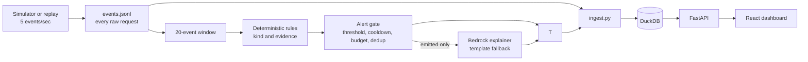

# Decider-Sec

Decider-Sec is a local log monitor that evaluates 20-event windows with deterministic rules. Rules decide and emit alerts. Bedrock can write a grounded explanation when explicitly enabled; a deterministic template is the fallback. Historical Ollama experiments are retained as study code and cannot change alerts.

## Dev snapshot

- Historical local-model comparisons are study results only; see [model comparison](#model-comparison).
- Current rules results and evasion-v1-v4 results are in [Results so far](#results-so-far-dev-only).



## Project status

Phase 1 artifacts are frozen and its evaluator passes 8/8 checks; the second-pass kappa was AI-produced, so independent human agreement remains unverified. The current alert path is rules-first; local Qwen results remain historical study artifacts. See [PROGRESS.md](PROGRESS.md) and [docs/DECIDER-SEC-SPEC.md](docs/DECIDER-SEC-SPEC.md) for status and phase criteria.

## Setup

Rules decide and emit alerts immediately. Bedrock only writes explanations when credentials are confirmed; deterministic templates are the fallback. AI is a second annotator and cannot change alert inclusion or suppression. Ollama adapter/evaluation code is study-only. The authorized-source allowlist mirrors simulator-declared authorized sources and is loaded from config with scope and expiry; labels never authorize a source.

## Planned commands

Use `make eval` for the Phase 1–4 evaluators, the dev rules report, and A–E ablation runner; it first verifies the locked-run counter is zero and Phase 5 remains unauthorized. Phase 2 runs baseline-only with Ollama skipped. Phase 3/4 use templates by default. `make study-phase2` is the separate historical Ollama study. No target runs Phase 5.

`make eval` includes Phase 1 integrity checks, which read hashes/counts from the locked test file and held-out stream files. Please run `python eval/phase1_eval.py` yourself when ready; it writes its report and config snapshot to `eval/runs/phase1-<timestamp>.json`. Codex has not run Phase 1 in this pass.

## Data provenance

- ModSecurity real-traffic WAF logs are the main external web source; full provenance and conversion notes are in [docs/DATA.md](docs/DATA.md).
- License: CC BY 4.0.
- Citation: Lucz & Forstner, *Data* 10(11), 186 (2025), [dataset paper](https://doi.org/10.3390/data10110186).
- CICIDS2017 flow data and the CSIC 2010 inspection are documented in [docs/DATA.md](docs/DATA.md).
- The golden set is owner-reviewed; independent human review remains unverified.

## Phase 1 data build

The deterministic simulator is configured in [`sim/scenarios.json`](sim/scenarios.json). Generate the artifacts in this order:

```bash
source venv/bin/activate
python sim/build_streams.py
python sim/select_real_windows.py
python sim/build_golden.py
python sim/finalize_data.py
python eval/phase1_eval.py
```

The current build creates five replay streams with 10,000 events each and 40 attack plus 15 hard-benign episodes. The golden files have the target class counts and include 120 ModSecurity attack windows split by source day. The project owner reports reviewing and verifying all 600 golden windows; their labels are marked final by owner review in [`data/golden/REVIEW_STATUS.md`](data/golden/REVIEW_STATUS.md). A blind AI second pass yields 73 eligible pairs and Cohen's kappa 0.7834; all eight automated checks pass. Because Codex helped create the original labels, this is not independent human agreement; see the [review record](data/annotations/second_annotator_filled.REVIEW.md). `sim/finalize_data.py` locks the test file and held-out streams and writes hashes to `data/VERSION`.

## Phase 2 baseline and Decider

The rules baseline and historical local-model study code are in [`baseline/`](baseline/README.md), [`decider/`](decider/README.md), and [`eval/phase2_eval.py`](eval/phase2_eval.py). The standard Phase 2 target uses `--skip-model`, reads dev windows and streams 01–03 only, and does not probe Ollama. Earlier model comparisons are summarized under [Results so far](#results-so-far-dev-only).

### Authorized-source allowlist

The config-backed allowlist in [`config/authorized_sources.json`](config/authorized_sources.json) mirrors the simulator-declared authorized source (`198.51.100.42`, emitted with `Approved-Internal-Scanner/2.0`). Each grant has an explicit scope and expiry; runtime authorization is loaded from config and never inferred from labels or event text. Expired, out-of-scope, and unlisted sources are not authorized. Focused boundary tests are in [`eval/test_authorization.py`](eval/test_authorization.py).

## Phase 3 gate, explanations, and pipeline

The stream processor is [`pipeline/run.py`](pipeline/run.py); rules decide and emit alerts immediately. Bedrock may explain emitted alerts when explicitly enabled and configured. Without Bedrock, or when it fails, the deterministic evidence-grounded template is used. Explanations cannot create, alter, or suppress alerts. Gate settings are in [`gate/gate.py`](gate/gate.py): 30-second cooldown and six alerts per rolling simulated 10 minutes by default.

DuckDB is a dashboard store, not a decision input. The API refreshes event rows when either new requests or new trace rows arrive, so an alert explanation can attach to a request that is already visible. Histogram severity bars come from raw statuses; alert badges come only from gate-emitted alerts. Rules evaluate non-overlapping 20-event windows.

Run `python eval/phase3_eval.py` for a dev-stream replay with rules decisions and template explanations; add `--real-explainer` only after the user confirms Bedrock credentials work. The prior model-review artifact is historical, not a production-pipeline result.

## Phase 4 dashboard, demo, and robustness

The previous Phase 3/4 reports are historical and include local-model explanation attempts; their 14+13 errors are preserved. The current code removes Ollama from the pipeline. Bedrock canary and refreshed Phase 3/4 reports await confirmation that AWS credentials work. The dashboard uses a dynamically imported chart. Final production Lighthouse was run in desktop mode while FastAPI served a disposable DuckDB containing dev stream 01; results are linked below.

## Locked final targets

These targets apply to the final evaluation. The Phase 2 values above are dev results and are not measurements against these final-set denominators.

| Metric | Target | Measured |
|---|---:|---|
| Attack recall | >= 0.90 (>= 87/96) | — |
| Benign false-speak rate | <= 0.05 (<= 6/120) | — |
| Precision | >= 0.90 | — |
| Hard-attack recall | >= 11/14 and >= 20 points above baseline | — |
| Hard-benign false-speak | <= 2/24 | — |
| Kind accuracy | >= 0.85 | — |
| Episode recall | >= 14/16 | — |
| False alerts on held-out streams | <= 2 total | — |
| Duplicate alerts per detected episode | <= 1.5 | — |
| Median time-to-detect | <= 40 events (~8 s) | — |
| Injection robustness | >= 29/30 attacks flagged; <= 1/20 benign false alerts; 0 canary leaks | — |
| Explanation grounding | 100% evidence IDs valid; >= 98% entities grounded | — |
| Decision latency | p50 <= 400 ms; p95 <= 1.2 s | — |

## Results so far (dev only)

Detector and ablation measurements use dev data only. Phase 1's separate integrity checks intentionally read locked-file hashes and counts when the user runs them. The locked-run counter remains 0 and Phase 5 remains unauthorized. The current rules and clean evasion-v4 results are in [the 2026-10-21 run](eval/runs/dev-rules-20261021T055255Z.json), the A–E dry run is [here](eval/runs/ablation-20261021T060624Z.json), and the latest headed browser measurement is [here](eval/runs/dashboard-playwright-20261021T060650Z.json). Lighthouse desktop results are [here](eval/runs/dashboard-lighthouse-desktop-final.json).

### Model comparison

| Model and scope | Attack recall | Hard-benign false speaks | Normal-benign false speaks | Kind accuracy | AUROC (model-called only) | Total latency p50 / p95 |
|---|---:|---:|---:|---:|---:|---:|
| [Rules baseline, shared 60-window sample](eval/runs/phase2-requested-qwen3-8b-sample60.json) | 21/24 | 3/6 | 0/24 | 18/21 | not run | not run |
| [Rules baseline, full dev](eval/runs/phase2-20261020T033832Z.json) (kind comparison: [audit](eval/runs/phase2-followup-audit-20261020T095052Z.json)) | 125/144 | 7/36 | 0/144 | 111/125 | not run | not run |
| [Current rules pipeline](eval/runs/dev-rules-20261021T055255Z.json) | 125/144 | 0/36 | 0/144 | 111/125 | not applicable | not applicable |
| Current Bedrock explainer (no run) | — | — | — | rules-owned | pending | pending |
| [qwen3:1.7b, 354 dev windows](eval/runs/phase2-requested-qwen3-1.7b.json) | 46/141 | 3/34 | 23/143 | 42/46 | 0.497 (n=314) | 6.22 / 10.14 s |
| [qwen3:4b, shared 60-window sample](eval/runs/phase2-requested-qwen3-4b-sample60.json) | 13/24 | 2/6 | 0/24 | 9/13 | 0.909 (n=52) | 13.59 / 32.60 s |
| [qwen3:8b, shared 60-window sample](eval/runs/phase2-requested-qwen3-8b-sample60.json) | 22/24 | 3/6 | 1/24 | 15/22 | 0.976 (n=54) | 30.89 / 67.46 s |

The shared-sample rules figures were computed deterministically on the exact window IDs in the 8B sample artifact, using the existing dev windows; no model calls were made.

On the shared sample, the rules recalled 21/24 and 8B recalled 22/24, a one-window difference; no recall advantage is claimed.

### Evasion v1-v4 (dev mutations)

| Evasion-v1 family | Before normalization | Current rules | qwen3:1.7b historical |
|---|---:|---:|---:|
| Double URL encoding | 18/20 | 18/20 | 8/20 |
| Case/comment obfuscation | 13/20 | 13/20 | 3/20 |
| Slow-rate across 5+ IPs | 20/20 | 20/20 | 0/20 |

Historical model values are from [the Evasion-v1 model run](eval/runs/evasion-qwen3-1.7b.json). Final post-normalization numbers are from the latest rules artifact; earlier intermediate normalization scoring reached 20/20 on case/comment, but the final comment-handling revision regressed to 13/20.

| Mutation family | Evasion-v2 pre-fix | Evasion-v2 post-fix, in-sample | Evasion-v3 pre-fix | Evasion-v3 post-fix, in-sample | Evasion-v4 current |
|---|---:|---:|---:|---:|---:|
| Slow, 15m spacing | — | — | 7/7 | 7/7 | 5/5 |
| Slow, 30m spacing | 0/20 | 0/20 | 0/7 | 0/7 | 0/5 |
| Slow, 45m spacing | — | — | 0/6 | 0/6 | 0/5 |
| Slow, 60m spacing | — | — | — | — | 0/5 |
| Triple / nested encoding (3 passes) | 17/20 | 17/20 | — | — | 4/4 |
| Nested encoding (4 passes) | — | — | — | — | 0/4 |
| HTML entities | — | — | 7/10 | 10/10 | 8/8 |
| Unicode escapes | — | — | 10/10 | 10/10 | 8/8 |
| Parser obfuscation / SQL splitting | 11/20 | 20/20 | 4/10 | 10/10 | 8/8 |
| Path separator confusion | — | — | 10/10 | 10/10 | — |
| Comment/case obfuscation | — | — | — | — | 8/8 |

Evasion-v2 pre-fix figures are preserved from [`dev-rules-20261020T181310Z.json`](eval/runs/dev-rules-20261020T181310Z.json). V1-v3 are the original frozen mutation sets; the clean v4 revision is [`evasion-v4-clean-dev.json`](eval/runs/evasion-v4-clean-dev.json), committed before rescoring. The first v4 candidate was contaminated by unchanged source payloads, so its per-family payload scores are invalid and remain documented in the run report. V4 covers 60 new dev mutations; its 3-pass nested cases pass while the intentionally deeper 4-pass cases do not.

V4 current recall totals **41/60**. V2/v3 post-fix figures are in-sample because those same development mutation families informed the rule and normalizer changes; they are not held-out estimates. The clean v4 fixture was built after the first v4 scoring exposed contamination, then committed before its own detector scoring.

Evasion-v4 was frozen before any detector run (candidate commit `e4756fdb`; clean, uncontaminated revision commit `89b5d1d7`). V1-v3 pre-fix references are retained in the current rules run. Normalization is capped at three repeated URL-decode passes, then decodes HTML and Unicode escapes, strips SQL comments, and collapses whitespace.

### What we found

- The exact per-source brute-force rule is at least five failed logins for the same username and source IP in a rolling 60 seconds, with no successful login for that username in the interval. The distributed rule is at least three distinct source IPs failing for the same username in a trailing 60 minutes, with no success for that username in that interval. Both apply; labels do not authorize sources.
- Current rules dev metrics are 125/144 attack recall, 111/125 kind accuracy, 0/36 hard-benign false speaks, and 0/144 normal-benign false speaks. Per-kind: brute force 24/24, credential stuffing 24/24, SQLi 16/24, XSS 14/18, path traversal 17/18, privilege escalation 18/18, scanner reconnaissance 12/18. Dev streams 01-03 had 0 false alerts each.
- Brute force exact rule: >=5 failures for the same username from one source IP in a rolling 60 seconds, with no matching success in that interval. Distributed brute force: same username fails from >=3 distinct IPs within 60 minutes and has no success in that interval. A separate auth-endpoint stuffing rule uses >=4 distinct failed usernames, >=2 distinct IPs, >=4 failures, and successes/attempts <=0.25 in 60 minutes. Thresholds were proposed using dev streams 01-03 only.
- With rotating usernames, the distinct-username stuffing rule catches v4 at 15-minute spacing (5/5; five failures fit within 60 minutes) but misses 30/45/60-minute spacing because those sequences contribute only three or fewer failures in the trailing hour. V2 30-minute slow rate remains 0/20; v3 remains 0/7 at 30m and 0/6 at 45m. The 60-minute change does not solve this attack shape.
- The final comment-normalization tweak restored SQL-split evasion recall (v3 4/10 to 10/10; v2 parser 11/20 to 20/20), but v1 case/comment ended at 13/20 after an intermediate 20/20. This regression is retained as a known result for follow-up.
- The 27 historical local-model explanation attempts (14 Phase 3, 13 Phase 4) failed. The known adapter exception is `Could not connect to Ollama at http://127.0.0.1:11434: [Errno 1] Operation not permitted`; the 27 summary artifacts omit individual raw errors, so they do not establish that every attempt had the identical exception. No retry or fix was made.
- Reviewer value did not separate attacks from benign controls: all 24 emitted dev-stream attack alerts were confirmed and all 7 formerly false-speaking hard-benign windows (with allowlist flag removed) were also confirmed; contested rate was 0% for each. The confirmed/contested badge and trace field were removed. The model can supply explanation hints only and cannot suppress or create alerts.
- The previous Phase 3/4 artifacts are retained as historical. A refreshed Phase 3/4 run through the final rules + Bedrock/template explanation path awaits user confirmation of Bedrock credentials. Bedrock smoke previously failed with an invalid security token; no live 20-alert run was performed.
- Dashboard desktop Lighthouse with a healthy API: LCP 733 ms, TBT 3 ms, JS transfer 243,713 bytes (263,881 bytes total). The dashboard remains under the 300 KB JS-transfer target. Headed Chrome used the AMD Radeon Graphics GPU for a synthetic 50k-row fixture: scroll 42.6 FPS average, p95 frame interval 50 ms; filter handler/network/render measured 3.1/291/62.2 ms (608 ms from the instrumented handler start to render completion). Only `/api/events?limit=200` and `/api/histogram` were requested for the filter; alert-card-to-evidence linkage passed. The broader fill-to-visible-results wall timer was 1,655 ms and includes the UI interaction and wait condition, so it is not the instrumented click-to-render interval.
- A–E ablation dry run on the same dev streams 01–03 (24 attacks, 9 hard-benign episodes): all variants detected 24/24 attacks. A (frozen naive rules), B (+cross-IP/stuffing), and C (+normalization) each emitted 1 hard-benign false alert (25 alerts); D (+allowlist) and E (+template explanation proxy; Bedrock pending) emitted 0 hard-benign false alerts (24 alerts). E made zero Bedrock calls. This small in-sample subset contains no attacks that distinguish A/B/C, so equal recall does not show those additions have no value on other data.
- Known detector limitations: rotating-username slow-rate attacks at spacing >=30 minutes remain mostly undetected; nested encoding requiring 4 or more decode passes exceeds the 3-pass normalizer; each dev stream spans only about 33 minutes, so these streams cannot validate long observation windows such as 60 minutes.
- Bedrock smoke only: configured AWS region was `local`; explicit us-west-2 identity, profile/model access, and one synthetic CLI invocation were attempted but failed with an invalid security token. Model access is unverified; no dev alert was sent and no 20-alert run occurred. The Haiku 4.5 profile used was `us.anthropic.claude-haiku-4-5-20251001-v1:0`.

- On the 1.7B 354-window run, recall was 46/141 versus the rules baseline's 125/144 on the full dev set; it caught 0/19 attacks the rules missed. The scopes differ, so the recall figures are not a paired comparison.
- Qwen3 4B was weak on the shared sample at 13/24, below the rules baseline's 21/24.
- Qwen3 8B had the strongest model-called confidence signal on the shared sample (AUROC 0.976, n=54), but total latency was 30.89/67.46 s p50/p95. On the earlier full-dev run, model and rules both recalled 125/144.
- On the earlier full-dev 8B artifact, rules kind accuracy was 111/125 and model kind accuracy was 96/125. The shared sample also has lower model kind accuracy than rules (18/21 for rules versus 9/13 for 4B and 15/22 for 8B); on the 1.7B scope, rules were 108/122 and the model 42/46. These are conditional on each detector's speaks, so the claim that every model is worse on kind accuracy is not supported across all scopes.
- Prompt processing dominated the 4B sample p50 latency (12.45 s prompt evaluation versus 1.10 s generation). The earlier 8B run was rules-gated: the model's speak decisions matched the rules because 200 no-candidate windows were skipped and every one of 160 candidate windows was sent to the model.

**Hardware:** historical Ollama study ran with 7.1 GiB host RAM, 6.0 GB runner, and 54% GPU / 46% CPU; physical GPU model was not recorded. The current headed Chrome run records its detected WebGL renderer and hardware-acceleration status in the Playwright artifact.

<details>
<summary>Earlier 8B run (rules-gated, context 8192, superseded)</summary>

Earlier completed run: [phase2-20261020T033832Z.json](eval/runs/phase2-20261020T033832Z.json).

| Phase 2 dev check | Target | Qwen3 8B result | Status |
|---|---:|---:|---|
| Schema validity | 360/360, no repairs | 360/360 | Pass |
| Pre-filter | Drop >=90% of events; preserve 24/24 attack episodes | 96.7%; 24/24 | Pass |
| Attack recall | >=85% (>=123/144) | 125/144 (86.8%) | Pass |
| Benign false-speak | <=8% (<=14/180) | 7/180 (3.9%) | Pass |
| Hard attacks | >=14/21 and >=20 percentage points above baseline | 29/29 detected; dev set has 29, target expects 21 | Blocked |
| Hard-benign false alerts | <=5/36 | 7/36 | Fail |
| Kind accuracy | >=80% of true positives | 96/125 (76.8%) | Fail |
| Confidence quality | AUROC >=0.93 with all 324 scored | 0.9008 (retired token-overwrite scorer; 192 skipped windows scored 0) | Fail |
| Latency | p50 <=400 ms; p95 <=1,200 ms | Evaluator: 0s / 44.2s across windows; model-call-only: 31.8s / 48.8s | Fail |

The run used context 8192. Its per-call latency is the full HTTP request duration, not time-to-first-token. The run used an 8B model on a host with 7.1 GiB RAM; the observed Ollama runner was 6.0 GB and split 54% GPU / 46% CPU, with 2.1 GiB swap in use.

</details>

### Known deviations

- **2026-10-20 — Hard-attack denominator:** the dev set has 29 hard attacks while the original gate expects 21. **Effect:** the gate is blocked on a mismatched denominator.
- **2026-10-20 — Attack source:** real traffic is ModSecurity-derived rather than ZAP/Burp. **Effect:** results describe this source and do not establish coverage on ZAP/Burp traffic.
- **2026-10-20 — Dashboard stack:** the dashboard is Next.js rather than Vite. **Effect:** the implementation differs from the specified frontend stack.
- **2026-10-20 — Agreement review:** second-pass kappa is AI-produced, not an independent human review. **Effect:** independent human agreement remains unverified.
- **2026-10-20 — Latency:** the p50 <=400 ms target is not met; model-call p50 values are in seconds in the linked run artifacts. **Effect:** the locked latency gate fails.
- **2026-10-20 — Kind accuracy:** the >=0.80 target is not met by the earlier 8B model result (96/125). **Effect:** the kind-accuracy gate fails.
- **2026-10-20 — Hard-attack improvement:** the required +20 percentage points over baseline cannot be met on this dev set because the baseline detects 29/29 hard attacks. **Effect:** there is no measurable headroom under the current denominator.
- **2026-10-21 — Model explanation calls:** final Phase 3/4 local-model explanation attempts failed (14/14 and 13/13 respectively); deterministic template explanations remained available and rule decisions were unaffected. **Effect:** model explanation quality is unverified.
- **2026-10-20 — Context length:** the earlier 8B run used context 8192, while the shared-sample runs use context 4096. **Effect:** latency and quality across those runs are not a controlled context-length comparison.
- **2026-10-21 — Bedrock credentials:** STS, model/profile metadata and one synthetic invocation failed with an invalid security token. **Effect:** Bedrock model access, latency, and rating are pending; the requested 20-alert run and live canary were not run.
- **2026-10-21 — Dashboard all-chunk sum:** summing every static JS chunk separately (including chunks not requested by this page) is 362,458 gzip bytes; Lighthouse's actual page script transfer is 243,696 bytes. **Effect:** page-transfer target passes; static all-chunk sum is not the page payload.
- **2026-10-21 — Historical v2 results:** the pre-fix artifact is retained unchanged; the 60-minute rule changes no v2 outcomes. **Effect:** v2 30-minute slow-rate remains 0/20.
