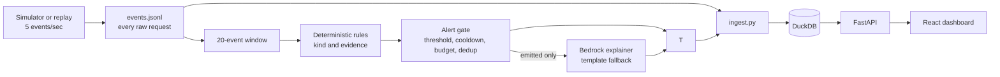

# Decider-Sec

Decider-Sec is a rules-first local log monitor that scores 20-event windows and emits alerts through a deterministic gate, with a Bedrock explainer and deterministic template fallback. The repository also contains a measured small-model study; those historical comparisons do not drive the current alert path.

## Architecture



**Demo:** `[Add demo GIF or screenshot here]`

## Headline locked-test results

| Locked target | Standard | Status-neutral | Status |
|---|---:|---:|---|
| Attack speak recall >=87/96 | MISSED 83/96 | MISSED 81/96 | MISSED |
| Simulated-benign false speaks <=6/120 | 0/120 | 0/120 | PASS |
| Precision >=0.90 | MISSED 83/94 (88.3%) | 81/89 (91.0%), registered value unavailable | Standard MISSED; neutral not verified |
| Hard-attack recall >=11/14 | Not evaluated as registered: evaluator flagged 6 test rows; registered cohort is 8 low-and-slow + 6 encoded | Same | Not evaluated as registered |
| Hard-attack improvement >=20 points over A | MISSED 0 points; A was 5/6 | MISSED 0 points; A was 5/6 | MISSED |
| Hard-benign false speaks <=2/24 | 0/24 | 0/24 | PASS |
| Kind accuracy >=0.85 | MISSED 65/83 | MISSED 65/81 | MISSED |
| Held-out episode recall >=14/16 | 16/16 | 16/16 | PASS |
| Held-out false alerts <=2 | 0 | 0 | PASS |
| Duplicates per detected episode <=1.5 | 0/16 | 0/16 | PASS |
| Median time-to-detect <=40 events | 20 events | 20 events | PASS |
| Explanation grounding | 8/16 emitted alerts graded; 8/8 IDs and 34/34 mentions in graded subset | Not reported | Incomplete; Bedrock pending |
| Injection robustness: >=29/30 attacks flagged, <=1/20 benign false alerts, 0 canary leaks | Not evaluated as registered | Not evaluated as registered | Not evaluated |
| Decision latency: p50 <=400 ms, p95 <=1.2 s | Not evaluated as registered | Not evaluated as registered | Not evaluated |

- Held-out streams 04–05 are simulator-generated; their episode recall was 16/16, with 0 false alerts and 0 duplicates per detected episode.
- The hard-attack result is not comparable to the registered 14-row cohort because the evaluator flagged 6 test rows.
- Template explanations are grounded by construction; live Bedrock grounding is pending.
- The artifact stores aggregates only, so per-window precision and wrong-kind rule attribution are unavailable.

## What's built

- Deterministic rules, evidence selection, and an alert gate with threshold, cooldown, budget, and deduplication.
- A pipeline for JSONL replay, FastAPI/DuckDB storage, and a React dashboard.
- Template explanations by default; optional Bedrock explanations for emitted alerts.
- A historical small-model evaluation study, separate from current alert decisions.

## Key findings

- The small-model study did not beat tuned rules overall; its scopes and historical model-call setup are documented in [detailed results](docs/RESULTS.md).
- A dev-only source/status shortcut audit had AUROC 1.000, a source-domain confound rather than evidence of general attack detection.
- Normalization improved some evasion families but increased lookalike false speaks before the scoped fix; v1/v2 results are separated in the detailed tables.
- Slow-rate attacks at 30 minutes or more and nested encoding requiring 4+ decode passes remain evasion limits.
- Benign examples and held-out streams are simulated; production benign generalization is unmeasured.

## Limitations

- Benign data is simulated.
- Status confound: shortcut AUROC 1.000 on the dev audit.
- The allowlist mirrors the simulator.
- Kind precedence can assign scanner reconnaissance to SQL injection.
- Slow-rate evasion at longer spacing remains weak.
- The second annotator was AI, not an independent human.
- Held-out streams are simulator-generated.
- The locked harness stored aggregates only, without per-window predictions or fired rules.
- Encoding requiring 4+ decode passes is not detected reliably.
- Bedrock evaluation is pending.

## Quickstart

Run a replay pipeline and start the dashboard API:

```bash
python pipeline/run.py data/streams/stream_01.jsonl --trace dashboard/data/stream_01_trace.jsonl
python dashboard/api/ingest.py data/streams/stream_01.jsonl dashboard/data/stream_01_trace.jsonl
python -m uvicorn dashboard.api.routes:app --host 127.0.0.1 --port 8000
```

In another terminal, start the dashboard frontend:

```bash
cd dashboard/web && npm install && npm run dev
```

Development evaluations (not the locked Phase 5 run):

```bash
make eval
make study-phase2
```

## Evaluation protocol

- Attempt 1 crashed: `NameError: name 'legacy_url_only' is not defined`; no metrics were written.
- Attempt 2 crashed: `RuntimeError: locked-run precondition changed after guard`; no metrics were written.
- Attempt 3 completed and wrote the sole metrics artifact; no tuning or rerun followed.

## Further reading

- [Detailed results](docs/RESULTS.md)
- [Data documentation](docs/DATA.md)
- [Decision log and specification](docs/DECIDER-SEC-SPEC.md)
- [Project progress](PROGRESS.md)
