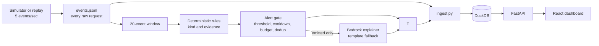

# Decider-Sec

Decider-Sec is a local log monitor that evaluates 20-event windows with deterministic rules. Rules decide and emit alerts. Bedrock can write a grounded explanation when explicitly enabled; a deterministic template is the fallback. Historical Ollama experiments are retained as study code and cannot change alerts.

## Dev snapshot

- Historical local-model comparisons are study results only; see [model comparison](#model-comparison).
- Current rules results and evasion-v1-v4 results are in [Results so far](#results-so-far-dev-only).

### Status confound and sensitivity

The 72 ModSecurity-derived dev attack windows contain statuses 301:255, 302:20, 304:37, 400:4, 401:4, 403:373, 404:572, 405:8, 500:32, and 503:135. The 252 simulated windows contain 200:3830, 302:163, 401:859, and 404:188. **Attack recall** means any speak on a labeled attack; **kind accuracy** means the correct kind among spoken attacks; **matching-kind recall** is the secondary count of attacks both spoken and assigned the true kind. Each is reported with a count and denominator. Status-neutral is a sensitivity analysis: for the dev comparison only, status is set to 200 on ModSecurity-marked events.

| Kind | n | Standard speak | Neutral speak | Standard matching-kind | Neutral matching-kind |
|---|---:|---:|---:|---:|---:|
| brute_force | 24 | 24/24 | 24/24 | 24/24 | 24/24 |
| credential_stuffing | 24 | 24/24 | 24/24 | 24/24 | 24/24 |
| path_traversal | 18 | 17/18 | 17/18 | 14/18 | 14/18 |
| priv_esc | 18 | 18/18 | 18/18 | 18/18 | 18/18 |
| scanner_recon | 18 | 12/18 | 10/18 | 12/18 | 10/18 |
| sqli | 24 | 16/24 | 13/24 | 9/24 | 9/24 |
| xss | 18 | 14/18 | 13/18 | 10/18 | 10/18 |
| **Overall** | **144** | **125/144** | **119/144** | **111/144** | **109/144** |

The earlier `125/144 → 109/144` wording incorrectly compared standard speak recall with neutral matching-kind recall. The apples-to-apples comparison is speak recall **125/144 → 119/144**, and matching-kind recall **111/144 → 109/144**. The four web-attack kinds similarly compare speak recall **59/78 → 53/78** and matching-kind recall **45/78 → 43/78**. These seven SQLi attacks were spoken as `scanner_recon` by the automated-probes rule in standard mode:

| SQLi window ID | Detected kind | Rule |
|---|---|---|
| modsec:03-Aug-2025:001200 | scanner_recon | automated probes target sensitive or unrelated endpoints |
| modsec:27-Jul-2025:000520 | scanner_recon | automated probes target sensitive or unrelated endpoints |
| modsec:04-Aug-2025:001160 | scanner_recon | automated probes target sensitive or unrelated endpoints |
| modsec:08-Aug-2025:000400 | scanner_recon | automated probes target sensitive or unrelated endpoints |
| modsec:15-Aug-2025:003380 | scanner_recon | automated probes target sensitive or unrelated endpoints |
| modsec:02-Aug-2025:002240 | scanner_recon | automated probes target sensitive or unrelated endpoints |
| modsec:07-Aug-2025:000400 | scanner_recon | automated probes target sensitive or unrelated endpoints |

Payload-signature rules do not require a 4xx/5xx or WAF-block status. The [shortcut audit](eval/runs/shortcut-audit-dev-20261021.json) AUROC finding remains a separate source-domain warning.

Six dev windows differ in speak outcome or detected kind:

| Window ID | True kind | Standard kind / rule | Neutral kind / rule |
|---|---|---|---|
| modsec:03-Aug-2025:001200 | sqli | scanner_recon / automated probes target sensitive or unrelated endpoints | none / no rule crossed its threshold |
| modsec:29-Jul-2025:000700 | xss | scanner_recon / automated probes target sensitive or unrelated endpoints | none / no rule crossed its threshold |
| modsec:04-Aug-2025:004840 | scanner_recon | scanner_recon / automated probes target sensitive or unrelated endpoints | none / no rule crossed its threshold |
| modsec:15-Aug-2025:003380 | sqli | scanner_recon / automated probes target sensitive or unrelated endpoints | none / no rule crossed its threshold |
| modsec:02-Aug-2025:002240 | sqli | scanner_recon / automated probes target sensitive or unrelated endpoints | none / no rule crossed its threshold |
| modsec:08-Aug-2025:002360 | scanner_recon | scanner_recon / automated probes target sensitive or unrelated endpoints | none / no rule crossed its threshold |

The A–E ablation runner also reports F, a status-neutral sensitivity analysis using the final rules and ModSecurity source markers (code-only). Its dev dry-run covers golden dev windows, dev streams 01–03, evasion v1–v4, and benign-lookalike v1/v2; artifact: [ablation-20261022T043652Z.json](eval/runs/ablation-20261022T043652Z.json). The golden-dev table includes both speak and matching-kind recall.

| Benign lookalike fixture | Before scoped fix | After scoped fix |
|---|---:|---:|
| v1 (in-sample; current rules) | 24/60 false speaks (12 escaped-comment XSS, 12 title traversal) | 0/60 |
| v2 (frozen before scoring; out-of-sample) | not scored before fix | 0/60 |

| Latency gate | Definition | Measured p50 / p95 |
|---|---|---:|
| Handler-to-render | Click handler start through completed render | 242.8 / 288.1 ms |
| Wall | Click action through filtered responses and rendered results | 344 / 394 ms |

Live Bedrock evaluation is pending. The explainer request now sets temperature to 0 explicitly. Run snapshots record the requested Bedrock region `us-west-2`, requested profile ID `us.anthropic.claude-haiku-4-5-20251001-v1:0`, `max_tokens=300`, connect/read timeouts of 4 seconds, and retry `max_attempts=0`; no Bedrock call was made for this update.

### Repo hygiene

`sim/capture/external/cicids2017` contains 3 tracked files. The only non-data references are this README, `PROGRESS.md`, and `docs/DATA.md`; no code or evaluator consumes that directory. Proposed cleanup: remove these auxiliary capture files from the repository and add a documented download/verify script that fetches the source files and checks each against recorded SHA-256 hashes before use. Repository history was not rewritten. Full `gitleaks detect --source .` was not run because it would read held-out/test contents, which are out of scope; no `gitleaks` executable is installed in the environment. No detector secrets scan was run against locked/held-out files.



## Project status

Phase 1 is complete: the saved report passes **8/8 checks** ([artifact](eval/runs/phase1-20261021T062137Z.json)). The second-pass kappa was AI-produced, so independent human agreement remains unverified. The current alert path is rules-first; local Qwen results remain historical study artifacts. See [PROGRESS.md](PROGRESS.md) and [docs/DECIDER-SEC-SPEC.md](docs/DECIDER-SEC-SPEC.md) for status and phase criteria.

## Setup

Rules decide and emit alerts immediately. Bedrock only writes explanations when credentials are confirmed; deterministic templates are the fallback. AI is a second annotator and cannot change alert inclusion or suppression. Ollama adapter/evaluation code is study-only. The authorized-source allowlist mirrors simulator-declared authorized sources and is loaded from config with scope and expiry; labels never authorize a source.

## Planned commands

Use `make eval` for the Phase 1–4 evaluators, the dev rules report, and A–E ablation runner; it first verifies the locked-run counter is zero and Phase 5 remains unauthorized. Phase 2 runs baseline-only with Ollama skipped. Phase 3/4 use templates by default. `make study-phase2` is the separate historical Ollama study. No target runs Phase 5.

`make eval` includes Phase 1 integrity checks, which read hashes/counts from the locked test file and held-out stream files. Phase 1 was run by the user and its report is committed at [`phase1-20261021T062137Z.json`](eval/runs/phase1-20261021T062137Z.json). No `.txt` log accompanied it.

## Data provenance

- ModSecurity real-traffic WAF logs are the main external web source; full provenance and conversion notes are in [docs/DATA.md](docs/DATA.md).
- License: CC BY 4.0.
- Citation: Lucz & Forstner, *Data* 10(11), 186 (2025), [dataset paper](https://doi.org/10.3390/data10110186).
- CICIDS2017 flow data and the CSIC 2010 inspection are documented in [docs/DATA.md](docs/DATA.md).
- The golden set is owner-reviewed; independent human review remains unverified.

## Phase 1 data build

The deterministic simulator is configured in [`sim/scenarios.json`](sim/scenarios.json). Generate the artifacts in this order:

```bash
source venv/bin/activate
python sim/build_streams.py
python sim/select_real_windows.py
python sim/build_golden.py
python sim/finalize_data.py
python eval/phase1_eval.py
```

The current build creates five replay streams with 10,000 events each and 40 attack plus 15 hard-benign episodes. The golden files have the target class counts and include 120 ModSecurity attack windows split by source day. The project owner reports reviewing and verifying all 600 golden windows; their labels are marked final by owner review in [`data/golden/REVIEW_STATUS.md`](data/golden/REVIEW_STATUS.md). Phase 1 passes **8/8 checks**: 0 shared dev/test sessions, 120/240 attack windows from ModSecurity, determinism hashes match, and locked-file integrity passes ([report](eval/runs/phase1-20261021T062137Z.json)). The AI second pass has 73 eligible pairs and Cohen's kappa **0.7834**; a rough aggregate-only 95% interval is **0.64–0.93**. This is not independent human agreement; see the [review record](data/annotations/second_annotator_filled.REVIEW.md). `sim/finalize_data.py` locks the test file and held-out streams and writes hashes to `data/VERSION`.

## Phase 2 baseline and Decider

The rules baseline and historical local-model study code are in [`baseline/`](baseline/README.md), [`decider/`](decider/README.md), and [`eval/phase2_eval.py`](eval/phase2_eval.py). The standard Phase 2 target uses `--skip-model`, reads dev windows and streams 01–03 only, and does not probe Ollama. Earlier model comparisons are summarized under [Results so far](#results-so-far-dev-only).

### Authorized-source allowlist

The config-backed allowlist in [`config/authorized_sources.json`](config/authorized_sources.json) mirrors the simulator-declared authorized source (`198.51.100.42`, emitted with `Approved-Internal-Scanner/2.0`). Each grant has an explicit scope and expiry; runtime authorization is loaded from config and never inferred from labels or event text. Expired, out-of-scope, and unlisted sources are not authorized. Focused boundary tests are in [`eval/test_authorization.py`](eval/test_authorization.py).

## Phase 3 gate, explanations, and pipeline

The stream processor is [`pipeline/run.py`](pipeline/run.py); rules decide and emit alerts immediately. Bedrock may explain emitted alerts when explicitly enabled and configured. Without Bedrock, or when it fails, the deterministic evidence-grounded template is used. Explanations cannot create, alter, or suppress alerts. Gate settings are in [`gate/gate.py`](gate/gate.py): 30-second cooldown and six alerts per rolling simulated 10 minutes by default.

DuckDB is a dashboard store, not a decision input. The API refreshes event rows when either new requests or new trace rows arrive, so an alert explanation can attach to a request that is already visible. Histogram severity bars come from raw statuses; alert badges come only from gate-emitted alerts. Rules evaluate non-overlapping 20-event windows.

Run `python eval/phase3_eval.py` for a dev-stream replay with rules decisions and template explanations; add `--real-explainer` only after the user confirms Bedrock credentials work. The prior model-review artifact is historical, not a production-pipeline result.

## Phase 4 dashboard, demo, and robustness

The previous Phase 3/4 reports are historical and include local-model explanation attempts; their 14+13 errors are preserved. The current code removes Ollama from the pipeline. Bedrock canary and refreshed Phase 3/4 reports await confirmation that AWS credentials work. The dashboard uses a dynamically imported chart. Final production Lighthouse was run in desktop mode while FastAPI served a disposable DuckDB containing dev stream 01; results are linked below.

## Locked final targets

These targets apply to the final evaluation. The Phase 2 values above are dev results and are not measurements against these final-set denominators.

| Metric | Target | Measured |
|---|---:|---|
| Attack recall | >= 0.90 (>= 87/96) | standard MISSED 83/96; status-neutral MISSED 81/96 (see final-20261022T052438Z.json) |
| Benign false-speak rate vs simulated benign traffic | <= 0.05 (<= 6/120) | standard 0/120; status-neutral 0/120 (see final-20261022T052438Z.json) |
| Precision | >= 0.90 | standard MISSED 83/94; status-neutral 81/89 (see final-20261022T052438Z.json) |
| Hard-attack recall | >= 11/14 and >= 20 points above baseline | standard MISSED 5/6; status-neutral MISSED 5/6 (see final-20261022T052438Z.json) |
| Hard-benign false-speak vs simulated benign traffic | <= 2/24 | standard 0/24; status-neutral 0/24 (see final-20261022T052438Z.json) |
| Kind accuracy | >= 0.85 | standard MISSED 65/83; status-neutral MISSED 65/81 (see final-20261022T052438Z.json) |
| Episode recall | >= 14/16 | standard 16/16; status-neutral 16/16 (see final-20261022T052438Z.json) |
| False alerts on held-out streams | <= 2 total | standard 0; status-neutral 0 (see final-20261022T052438Z.json) |
| Duplicate alerts per detected episode | <= 1.5 | standard 0/16; status-neutral 0/16 (see final-20261022T052438Z.json) |
| Median time-to-detect | <= 40 events (~8 s) | standard 20.0 events; status-neutral 20.0 events (see final-20261022T052438Z.json) |
| Injection robustness | >= 29/30 attacks flagged; <= 1/20 benign false alerts; 0 canary leaks | pending: not part of the locked run |
| Explanation grounding | 100% evidence IDs valid; >= 98% entities grounded | evidence IDs 8/8; entity grounding 34/34 (template; see final-20261022T052438Z.json) |
| Decision latency | p50 <= 400 ms; p95 <= 1.2 s | pending: not part of the locked run |


### Phase 5 detailed results

Run artifact: `final-20261022T052438Z.json`. `MISSED` marks a failed target.

Attempt 1 crashed in the harness with `NameError: name 'legacy_url_only' is not defined`. Attempt 2 crashed because the guard rejected the harness's own counter update: `RuntimeError: locked-run precondition changed after guard`. Neither attempt wrote metrics. This is attempt 3; it completed and wrote the metrics in the run artifact. The Phase 5 equivalence gate passed in a scratch checkout before the locked run.

#### Golden-test metrics by mode

| Metric | Standard | Status-neutral |
|---|---:|---:|
| Attack speak recall | MISSED 83/96 | MISSED 81/96 |
| Precision | MISSED 83/94 | 81/89 |
| Kind accuracy among spoken attacks | MISSED 65/83 | MISSED 65/81 |
| Matching-kind recall | 65/96 | 65/96 |
| Simulated-benign false speaks | 0/120 | 0/120 |
| Hard-attack recall | MISSED 5/6 | MISSED 5/6 |
| Hard-benign false speaks | 0/24 | 0/24 |

The registered hard-attack target is at least 11/14 and at least 20 percentage points above variant A. The evaluator found six golden-test rows marked `hard`, so the measured hard-attack result is 5/6 in both modes; it does not establish the registered 14-row target. Variant A was also 5/6. The recorded miss is based on the registered target.

#### Missed locked targets

| Mode | Target | Measured |
|---|---|---:|
| Standard | Attack speak recall >= 87/96 | MISSED 83/96 |
| Standard | Precision >= 0.90 | MISSED 83/94 |
| Standard | Kind accuracy >= 0.85 | MISSED 65/83 |
| Standard | Hard-attack recall >= 11/14 and >=20 points above A | MISSED 5/6; 0.00 points above A |
| Status-neutral | Attack speak recall >= 87/96 | MISSED 81/96 |
| Status-neutral | Kind accuracy >= 0.85 | MISSED 65/81 |
| Status-neutral | Hard-attack recall >= 11/14 and >=20 points above A | MISSED 5/6; 0.00 points above A |

#### Golden test source split

| Source cohort | Kind | n | Speak recall | Matching-kind recall |
|---|---|---:|---:|---:|
| standard · real (ModSecurity-derived) | path_traversal | 12 | 12/12 | 4/12 |
| standard · real (ModSecurity-derived) | scanner_recon | 12 | 7/12 | 7/12 |
| standard · real (ModSecurity-derived) | sqli | 16 | 11/16 | 4/16 |
| standard · real (ModSecurity-derived) | xss | 8 | 5/8 | 2/8 |
| standard · simulator_generated | brute_force | 16 | 16/16 | 16/16 |
| standard · simulator_generated | credential_stuffing | 16 | 16/16 | 16/16 |
| standard · simulator_generated | priv_esc | 12 | 12/12 | 12/12 |
| standard · simulator_generated | xss | 4 | 4/4 | 4/4 |
| status-neutral · real (ModSecurity-derived) | path_traversal | 12 | 12/12 | 4/12 |
| status-neutral · real (ModSecurity-derived) | scanner_recon | 12 | 7/12 | 7/12 |
| status-neutral · real (ModSecurity-derived) | sqli | 16 | 10/16 | 4/16 |
| status-neutral · real (ModSecurity-derived) | xss | 8 | 4/8 | 2/8 |
| status-neutral · simulator_generated | brute_force | 16 | 16/16 | 16/16 |
| status-neutral · simulator_generated | credential_stuffing | 16 | 16/16 | 16/16 |
| status-neutral · simulator_generated | priv_esc | 12 | 12/12 | 12/12 |
| status-neutral · simulator_generated | xss | 4 | 4/4 | 4/4 |

#### A–F ablation on held-out streams

| Variant | Golden speak recall | Kind accuracy | Matching-kind recall | Held-out episode recall | False alerts | Duplicates | Median detect events |
|---|---:|---:|---:|---:|---:|---:|---:|
| A | 83/96 | 65/83 | 65/96 | 16/16 | 2 | 0 | 20.0 |
| B | 83/96 | 65/83 | 65/96 | 16/16 | 2 | 0 | 20.0 |
| C | 83/96 | 65/83 | 65/96 | 16/16 | 2 | 0 | 20.0 |
| D | 83/96 | 65/83 | 65/96 | 16/16 | 0 | 0 | 20.0 |
| E | MISSED 83/96 | MISSED 65/83 | 65/96 | 16/16 | 0 | 0 | 20.0 |
| F | MISSED 81/96 | MISSED 65/81 | 65/96 | 16/16 | 0 | 0 | 20.0 |

#### Held-out stream detail (simulator-generated)

Streams 04–05 are simulator-generated. An alert matches an episode when `alert.end >= episode.start_idx` and `alert.start < episode.end_idx`; the earliest overlapping alert end sets detection delay.

| Variant | Stream | Episode recall | False alerts | Duplicates | Median detect events |
|---|---|---:|---:|---:|---:|
| E | stream_04 | 8/8 | 0 | 0 | 20.0 |
| E | stream_05 | 8/8 | 0 | 0 | 20.0 |
| F | stream_04 | 8/8 | 0 | 0 | 20.0 |
| F | stream_05 | 8/8 | 0 | 0 | 20.0 |

#### Evasion and lookalike results

| Variant | Fixture | Family / category | Detected false speaks / n |
|---|---|---|---:|
| A | v1 | case_comment_obfuscation | 13/20 |
| A | v1 | double_url_encoding | 18/20 |
| A | v1 | slow_rate_5plus_ips | 0/20 |
| A | v2 | parser_obfuscation | 11/20 |
| A | v2 | slow_rate_10ip_30m_rotating_users | 0/20 |
| A | v2 | triple_encoding | 17/20 |
| A | v3 | encoding_html_entity | 7/10 |
| A | v3 | encoding_unicode_escape | 10/10 |
| A | v3 | parser_path_separator_confusion | 10/10 |
| A | v3 | parser_sql_keyword_splitting | 4/10 |
| A | v3 | slow_rate_15m_rotating_usernames_20ip | 0/7 |
| A | v3 | slow_rate_30m_rotating_usernames_20ip | 0/7 |
| A | v3 | slow_rate_45m_rotating_usernames_20ip | 0/6 |
| A | v4 | comment_case_obfuscation | 0/8 |
| A | v4 | html_entity_encoding | 0/8 |
| A | v4 | nested_triple_encoding_3pass | 4/4 |
| A | v4 | nested_triple_encoding_4pass | 0/4 |
| A | v4 | slow_rate_15m_rotating_users_14ip | 0/5 |
| A | v4 | slow_rate_30m_rotating_users_14ip | 0/5 |
| A | v4 | slow_rate_45m_rotating_users_14ip | 0/5 |
| A | v4 | slow_rate_60m_rotating_users_14ip | 0/5 |
| A | v4 | sql_keyword_splitting | 0/8 |
| A | v4 | unicode_escape_encoding | 0/8 |
| A | lookalike-v1 | apostrophes_in_names | 0/12 |
| A | lookalike-v1 | html_tags_in_comment_text | 0/12 |
| A | lookalike-v1 | long_encoded_parameters | 0/12 |
| A | lookalike-v1 | sql_keywords_in_search | 0/12 |
| A | lookalike-v1 | traversal_looking_document_titles | 12/12 |
| A | lookalike-v2 | apostrophes_in_names | 0/12 |
| A | lookalike-v2 | html_tags_in_comment_text | 0/12 |
| A | lookalike-v2 | long_encoded_parameters | 0/12 |
| A | lookalike-v2 | sql_keywords_in_search | 0/12 |
| A | lookalike-v2 | traversal_looking_document_titles | 12/12 |
| B | v1 | case_comment_obfuscation | 13/20 |
| B | v1 | double_url_encoding | 18/20 |
| B | v1 | slow_rate_5plus_ips | 20/20 |
| B | v2 | parser_obfuscation | 11/20 |
| B | v2 | slow_rate_10ip_30m_rotating_users | 0/20 |
| B | v2 | triple_encoding | 17/20 |
| B | v3 | encoding_html_entity | 7/10 |
| B | v3 | encoding_unicode_escape | 10/10 |
| B | v3 | parser_path_separator_confusion | 10/10 |
| B | v3 | parser_sql_keyword_splitting | 4/10 |
| B | v3 | slow_rate_15m_rotating_usernames_20ip | 7/7 |
| B | v3 | slow_rate_30m_rotating_usernames_20ip | 0/7 |
| B | v3 | slow_rate_45m_rotating_usernames_20ip | 0/6 |
| B | v4 | comment_case_obfuscation | 0/8 |
| B | v4 | html_entity_encoding | 0/8 |
| B | v4 | nested_triple_encoding_3pass | 4/4 |
| B | v4 | nested_triple_encoding_4pass | 0/4 |
| B | v4 | slow_rate_15m_rotating_users_14ip | 5/5 |
| B | v4 | slow_rate_30m_rotating_users_14ip | 0/5 |
| B | v4 | slow_rate_45m_rotating_users_14ip | 0/5 |
| B | v4 | slow_rate_60m_rotating_users_14ip | 0/5 |
| B | v4 | sql_keyword_splitting | 0/8 |
| B | v4 | unicode_escape_encoding | 0/8 |
| B | lookalike-v1 | apostrophes_in_names | 0/12 |
| B | lookalike-v1 | html_tags_in_comment_text | 0/12 |
| B | lookalike-v1 | long_encoded_parameters | 0/12 |
| B | lookalike-v1 | sql_keywords_in_search | 0/12 |
| B | lookalike-v1 | traversal_looking_document_titles | 0/12 |
| B | lookalike-v2 | apostrophes_in_names | 0/12 |
| B | lookalike-v2 | html_tags_in_comment_text | 0/12 |
| B | lookalike-v2 | long_encoded_parameters | 0/12 |
| B | lookalike-v2 | sql_keywords_in_search | 0/12 |
| B | lookalike-v2 | traversal_looking_document_titles | 0/12 |
| C | v1 | case_comment_obfuscation | 13/20 |
| C | v1 | double_url_encoding | 18/20 |
| C | v1 | slow_rate_5plus_ips | 20/20 |
| C | v2 | parser_obfuscation | 20/20 |
| C | v2 | slow_rate_10ip_30m_rotating_users | 0/20 |
| C | v2 | triple_encoding | 17/20 |
| C | v3 | encoding_html_entity | 10/10 |
| C | v3 | encoding_unicode_escape | 10/10 |
| C | v3 | parser_path_separator_confusion | 10/10 |
| C | v3 | parser_sql_keyword_splitting | 10/10 |
| C | v3 | slow_rate_15m_rotating_usernames_20ip | 7/7 |
| C | v3 | slow_rate_30m_rotating_usernames_20ip | 0/7 |
| C | v3 | slow_rate_45m_rotating_usernames_20ip | 0/6 |
| C | v4 | comment_case_obfuscation | 8/8 |
| C | v4 | html_entity_encoding | 8/8 |
| C | v4 | nested_triple_encoding_3pass | 4/4 |
| C | v4 | nested_triple_encoding_4pass | 0/4 |
| C | v4 | slow_rate_15m_rotating_users_14ip | 5/5 |
| C | v4 | slow_rate_30m_rotating_users_14ip | 0/5 |
| C | v4 | slow_rate_45m_rotating_users_14ip | 0/5 |
| C | v4 | slow_rate_60m_rotating_users_14ip | 0/5 |
| C | v4 | sql_keyword_splitting | 8/8 |
| C | v4 | unicode_escape_encoding | 8/8 |
| C | lookalike-v1 | apostrophes_in_names | 0/12 |
| C | lookalike-v1 | html_tags_in_comment_text | 0/12 |
| C | lookalike-v1 | long_encoded_parameters | 0/12 |
| C | lookalike-v1 | sql_keywords_in_search | 0/12 |
| C | lookalike-v1 | traversal_looking_document_titles | 0/12 |
| C | lookalike-v2 | apostrophes_in_names | 0/12 |
| C | lookalike-v2 | html_tags_in_comment_text | 0/12 |
| C | lookalike-v2 | long_encoded_parameters | 0/12 |
| C | lookalike-v2 | sql_keywords_in_search | 0/12 |
| C | lookalike-v2 | traversal_looking_document_titles | 0/12 |
| D | v1 | case_comment_obfuscation | 13/20 |
| D | v1 | double_url_encoding | 18/20 |
| D | v1 | slow_rate_5plus_ips | 20/20 |
| D | v2 | parser_obfuscation | 20/20 |
| D | v2 | slow_rate_10ip_30m_rotating_users | 0/20 |
| D | v2 | triple_encoding | 17/20 |
| D | v3 | encoding_html_entity | 10/10 |
| D | v3 | encoding_unicode_escape | 10/10 |
| D | v3 | parser_path_separator_confusion | 10/10 |
| D | v3 | parser_sql_keyword_splitting | 10/10 |
| D | v3 | slow_rate_15m_rotating_usernames_20ip | 7/7 |
| D | v3 | slow_rate_30m_rotating_usernames_20ip | 0/7 |
| D | v3 | slow_rate_45m_rotating_usernames_20ip | 0/6 |
| D | v4 | comment_case_obfuscation | 8/8 |
| D | v4 | html_entity_encoding | 8/8 |
| D | v4 | nested_triple_encoding_3pass | 4/4 |
| D | v4 | nested_triple_encoding_4pass | 0/4 |
| D | v4 | slow_rate_15m_rotating_users_14ip | 5/5 |
| D | v4 | slow_rate_30m_rotating_users_14ip | 0/5 |
| D | v4 | slow_rate_45m_rotating_users_14ip | 0/5 |
| D | v4 | slow_rate_60m_rotating_users_14ip | 0/5 |
| D | v4 | sql_keyword_splitting | 8/8 |
| D | v4 | unicode_escape_encoding | 8/8 |
| D | lookalike-v1 | apostrophes_in_names | 0/12 |
| D | lookalike-v1 | html_tags_in_comment_text | 0/12 |
| D | lookalike-v1 | long_encoded_parameters | 0/12 |
| D | lookalike-v1 | sql_keywords_in_search | 0/12 |
| D | lookalike-v1 | traversal_looking_document_titles | 0/12 |
| D | lookalike-v2 | apostrophes_in_names | 0/12 |
| D | lookalike-v2 | html_tags_in_comment_text | 0/12 |
| D | lookalike-v2 | long_encoded_parameters | 0/12 |
| D | lookalike-v2 | sql_keywords_in_search | 0/12 |
| D | lookalike-v2 | traversal_looking_document_titles | 0/12 |
| E | v1 | case_comment_obfuscation | 13/20 |
| E | v1 | double_url_encoding | 18/20 |
| E | v1 | slow_rate_5plus_ips | 20/20 |
| E | v2 | parser_obfuscation | 20/20 |
| E | v2 | slow_rate_10ip_30m_rotating_users | 0/20 |
| E | v2 | triple_encoding | 17/20 |
| E | v3 | encoding_html_entity | 10/10 |
| E | v3 | encoding_unicode_escape | 10/10 |
| E | v3 | parser_path_separator_confusion | 10/10 |
| E | v3 | parser_sql_keyword_splitting | 10/10 |
| E | v3 | slow_rate_15m_rotating_usernames_20ip | 7/7 |
| E | v3 | slow_rate_30m_rotating_usernames_20ip | 0/7 |
| E | v3 | slow_rate_45m_rotating_usernames_20ip | 0/6 |
| E | v4 | comment_case_obfuscation | 8/8 |
| E | v4 | html_entity_encoding | 8/8 |
| E | v4 | nested_triple_encoding_3pass | 4/4 |
| E | v4 | nested_triple_encoding_4pass | 0/4 |
| E | v4 | slow_rate_15m_rotating_users_14ip | 5/5 |
| E | v4 | slow_rate_30m_rotating_users_14ip | 0/5 |
| E | v4 | slow_rate_45m_rotating_users_14ip | 0/5 |
| E | v4 | slow_rate_60m_rotating_users_14ip | 0/5 |
| E | v4 | sql_keyword_splitting | 8/8 |
| E | v4 | unicode_escape_encoding | 8/8 |
| E | lookalike-v1 | apostrophes_in_names | 0/12 |
| E | lookalike-v1 | html_tags_in_comment_text | 0/12 |
| E | lookalike-v1 | long_encoded_parameters | 0/12 |
| E | lookalike-v1 | sql_keywords_in_search | 0/12 |
| E | lookalike-v1 | traversal_looking_document_titles | 0/12 |
| E | lookalike-v2 | apostrophes_in_names | 0/12 |
| E | lookalike-v2 | html_tags_in_comment_text | 0/12 |
| E | lookalike-v2 | long_encoded_parameters | 0/12 |
| E | lookalike-v2 | sql_keywords_in_search | 0/12 |
| E | lookalike-v2 | traversal_looking_document_titles | 0/12 |
| F | v1 | case_comment_obfuscation | 13/20 |
| F | v1 | double_url_encoding | 18/20 |
| F | v1 | slow_rate_5plus_ips | 20/20 |
| F | v2 | parser_obfuscation | 20/20 |
| F | v2 | slow_rate_10ip_30m_rotating_users | 0/20 |
| F | v2 | triple_encoding | 17/20 |
| F | v3 | encoding_html_entity | 10/10 |
| F | v3 | encoding_unicode_escape | 10/10 |
| F | v3 | parser_path_separator_confusion | 10/10 |
| F | v3 | parser_sql_keyword_splitting | 10/10 |
| F | v3 | slow_rate_15m_rotating_usernames_20ip | 7/7 |
| F | v3 | slow_rate_30m_rotating_usernames_20ip | 0/7 |
| F | v3 | slow_rate_45m_rotating_usernames_20ip | 0/6 |
| F | v4 | comment_case_obfuscation | 8/8 |
| F | v4 | html_entity_encoding | 8/8 |
| F | v4 | nested_triple_encoding_3pass | 4/4 |
| F | v4 | nested_triple_encoding_4pass | 0/4 |
| F | v4 | slow_rate_15m_rotating_users_14ip | 5/5 |
| F | v4 | slow_rate_30m_rotating_users_14ip | 0/5 |
| F | v4 | slow_rate_45m_rotating_users_14ip | 0/5 |
| F | v4 | slow_rate_60m_rotating_users_14ip | 0/5 |
| F | v4 | sql_keyword_splitting | 8/8 |
| F | v4 | unicode_escape_encoding | 8/8 |
| F | lookalike-v1 | apostrophes_in_names | 0/12 |
| F | lookalike-v1 | html_tags_in_comment_text | 0/12 |
| F | lookalike-v1 | long_encoded_parameters | 0/12 |
| F | lookalike-v1 | sql_keywords_in_search | 0/12 |
| F | lookalike-v1 | traversal_looking_document_titles | 0/12 |
| F | lookalike-v2 | apostrophes_in_names | 0/12 |
| F | lookalike-v2 | html_tags_in_comment_text | 0/12 |
| F | lookalike-v2 | long_encoded_parameters | 0/12 |
| F | lookalike-v2 | sql_keywords_in_search | 0/12 |
| F | lookalike-v2 | traversal_looking_document_titles | 0/12 |

Bedrock metrics: pending: not part of the locked run.
## Results so far (dev only)

Phase 5 has three recorded attempts and one metric-writing run. The current rules and clean evasion-v4 results are in [the 2026-10-21 run](eval/runs/dev-rules-20261021T055255Z.json), the A–E dry run is [here](eval/runs/ablation-20261021T064132Z.json), and the latest headed browser measurement is [here](eval/runs/dashboard-playwright-20261021T064750Z.json). The real-API filter profile is [here](eval/runs/dashboard-real-api-filter-20261021T064604Z.json); its frame trace is [here](eval/runs/dashboard-scroll-trace-20261021T064750Z.json). Lighthouse desktop results are [here](eval/runs/dashboard-lighthouse-desktop-final.json).

### Recall by data source (dev)

The golden-set count manifest gives 144 dev and 96 test attack windows (240 total). The ModSecurity selection manifest declares 72 real windows in dev and 48 in test; the rest are simulator-generated. These source counts are derived from manifest counts and declared per-kind selection quotas, without reading test or held-out window contents. Recall below is the current dev rules result; for mixed-source XSS it is not split by provenance.

| Kind / source family | Dev ModSecurity | Dev simulated | Test ModSecurity | Test simulated | Dev recall |
|---|---:|---:|---:|---:|---:|
| sqli (real-traffic family) | 24 | 0 | 16 | 0 | 16/24 |
| xss (real-traffic family; mixed) | 12 | 6 | 8 | 4 | 14/18 |
| path_traversal (real-traffic family) | 18 | 0 | 12 | 0 | 17/18 |
| scanner_recon (real-traffic family) | 18 | 0 | 12 | 0 | 12/18 |
| brute_force (simulated only) | 0 | 24 | 0 | 16 | 24/24 |
| credential_stuffing (simulated only) | 0 | 24 | 0 | 16 | 24/24 |
| priv_esc (simulated only) | 0 | 18 | 0 | 12 | 18/18 |
| **Total** | **72** | **72** | **48** | **48** | **125/144** |

Brute force, credential stuffing, and privilege escalation are **100% simulated** in both splits. Simulated-kind recall is not a real-world estimate: the simulator and rules were co-developed. The perfect/near-perfect simulated-kind results should not be generalized to production traffic.

**Known confound:** the dev-only non-content shortcut audit ([report](eval/runs/shortcut-audit-dev-20261021.json)) trained L2 logistic regression to distinguish ModSecurity attack windows from simulated benign windows using coarse user-agent family, status distribution, field-presence rates, byte-null rate, and timing/within-window metadata. Five-fold stratified CV pooled AUROC was **1.000** (folds 1.000 each; 72 real attacks, 180 simulated benign). The top five permutation drops were `status_4xx` (0.002593 AUROC), `presence_username` (0.000741), then `event_count`, `bytes_null_rate`, and `unique_source_ips` (each 0.000000). Removing the top 1 feature left AUROC **1.000**; removing the top 3 yielded **0.9977**; removing the top 5 yielded **0.9978**. The remaining metadata still separates source domains nearly perfectly; this is a source shortcut warning, not evidence of detector quality. The audit did not change data or rules.

The audit run snapshot records explainer prompt SHA-256 `29aa38e29b246d168b595fb9d387e85c06b8f0da18301f7df6b6c743ae274f8d`, requested Bedrock region `us-west-2`, and requested inference profile `us.anthropic.claude-haiku-4-5-20251001-v1:0`. The actual AWS region/model environment variables were unset. The explainer request uses `max_tokens=300`, leaves temperature unspecified (provider default), sets retries to `max_attempts=0`, and uses 4-second connect/read timeouts. Rules are deterministic; `evaluation_seed` is null.

### Model comparison

| Model and scope | Attack recall (real / simulated) | Hard-benign false speaks vs simulated benign traffic | Normal-benign false speaks vs simulated benign traffic | Kind accuracy | AUROC (model-called only) | Total latency p50 / p95 |
|---|---:|---:|---:|---:|---:|---:|
| [Rules baseline, shared 60-window sample](eval/runs/phase2-requested-qwen3-8b-sample60.json) | 21/24 (source split not recorded) | 3/6 | 0/24 | 18/21 | not run | not run |
| [Rules baseline, full dev](eval/runs/phase2-20261020T033832Z.json) (kind comparison: [audit](eval/runs/phase2-followup-audit-20261020T095052Z.json)) | 125/144 (source split not recorded) | 7/36 | 0/144 | 111/125 | not run | not run |
| [Current rules pipeline](eval/runs/dev-rules-20261021T055255Z.json) | 53/72 real; 72/72 simulated (125/144 overall) | 0/36 | 0/144 | 111/125 | not applicable | not applicable |
| Current Bedrock explainer (no run) | — | — | — | rules-owned | pending | pending |
| [qwen3:1.7b, 354 dev windows](eval/runs/phase2-requested-qwen3-1.7b.json) | 46/141 | 3/34 | 23/143 | 42/46 | 0.497 (n=314) | 6.22 / 10.14 s |
| [qwen3:4b, shared 60-window sample](eval/runs/phase2-requested-qwen3-4b-sample60.json) | 13/24 | 2/6 | 0/24 | 9/13 | 0.909 (n=52) | 13.59 / 32.60 s |
| [qwen3:8b, shared 60-window sample](eval/runs/phase2-requested-qwen3-8b-sample60.json) | 22/24 | 3/6 | 1/24 | 15/22 | 0.976 (n=54) | 30.89 / 67.46 s |

The shared-sample rules figures were computed deterministically on the exact window IDs in the 8B sample artifact, using the existing dev windows; no model calls were made.

On the shared sample, the rules recalled 21/24 and 8B recalled 22/24, a one-window difference; no recall advantage is claimed.

### Evasion v1-v4 (dev mutations)

| Evasion-v1 family | Before normalization | Current rules | qwen3:1.7b historical |
|---|---:|---:|---:|
| Double URL encoding | 18/20 | 18/20 | 8/20 |
| Case/comment obfuscation | 13/20 | 13/20 | 3/20 |
| Slow-rate across 5+ IPs | 20/20 | 20/20 | 0/20 |

Historical model values are from [the Evasion-v1 model run](eval/runs/evasion-qwen3-1.7b.json). Final post-normalization numbers are from the latest rules artifact; earlier intermediate normalization scoring reached 20/20 on case/comment, but the final comment-handling revision regressed to 13/20.

| Mutation family | Evasion-v2 pre-fix | Evasion-v2 post-fix, in-sample | Evasion-v3 pre-fix | Evasion-v3 post-fix, in-sample | Evasion-v4 current |
|---|---:|---:|---:|---:|---:|
| Slow, 15m spacing | — | — | 7/7 | 7/7 | 5/5 |
| Slow, 30m spacing | 0/20 | 0/20 | 0/7 | 0/7 | 0/5 |
| Slow, 45m spacing | — | — | 0/6 | 0/6 | 0/5 |
| Slow, 60m spacing | — | — | — | — | 0/5 |
| Triple / nested encoding (3 passes) | 17/20 | 17/20 | — | — | 4/4 |
| Nested encoding (4 passes) | — | — | — | — | 0/4 |
| HTML entities | — | — | 7/10 | 10/10 | 8/8 |
| Unicode escapes | — | — | 10/10 | 10/10 | 8/8 |
| Parser obfuscation / SQL splitting | 11/20 | 20/20 | 4/10 | 10/10 | 8/8 |
| Path separator confusion | — | — | 10/10 | 10/10 | — |
| Comment/case obfuscation | — | — | — | — | 8/8 |

Evasion-v2 pre-fix figures are preserved from [`dev-rules-20261020T181310Z.json`](eval/runs/dev-rules-20261020T181310Z.json). V1-v3 are the original frozen mutation sets; the clean v4 revision is [`evasion-v4-clean-dev.json`](eval/runs/evasion-v4-clean-dev.json), committed before rescoring. The first v4 candidate was contaminated by unchanged source payloads, so its per-family payload scores are invalid and remain documented in the run report. V4 covers 60 new dev mutations; its 3-pass nested cases pass while the intentionally deeper 4-pass cases do not.

V4 current recall totals **41/60**. V2/v3 post-fix figures are in-sample because those same development mutation families informed the rule and normalizer changes; they are not held-out estimates. The clean v4 fixture was built after the first v4 scoring exposed contamination, then committed before its own detector scoring.

Evasion-v4 was frozen before any detector run (candidate commit `e4756fdb`; clean, uncontaminated revision commit `89b5d1d7`). V1-v3 pre-fix references are retained in the current rules run. Normalization is capped at three repeated URL-decode passes, then decodes HTML and Unicode escapes, strips SQL comments, and collapses whitespace.

### What we found

- The exact per-source brute-force rule is at least five failed logins for the same username and source IP in a rolling 60 seconds, with no successful login for that username in the interval. The distributed rule is at least three distinct source IPs failing for the same username in a trailing 60 minutes, with no success for that username in that interval. Both apply; labels do not authorize sources.
- Current rules dev metrics are 125/144 attack recall (53/72 ModSecurity, 72/72 simulated), 111/125 kind accuracy, 0/36 hard-benign false speaks vs simulated benign traffic, and 0/144 normal-benign false speaks vs simulated benign traffic. Per-kind: brute force 24/24, credential stuffing 24/24, SQLi 16/24, XSS 14/18, path traversal 17/18, privilege escalation 18/18, scanner reconnaissance 12/18. Dev streams 01-03 had 0 false alerts each.
- Source-stratified dev recall is 53/72 on ModSecurity attacks and 72/72 on simulated attacks (125/144 overall). See [Recall by data source](#recall-by-data-source-dev); simulated-kind results are not a real-world estimate.
- Brute force exact rule: >=5 failures for the same username from one source IP in a rolling 60 seconds, with no matching success in that interval. Distributed brute force: same username fails from >=3 distinct IPs within 60 minutes and has no success in that interval. A separate auth-endpoint stuffing rule uses >=4 distinct failed usernames, >=2 distinct IPs, >=4 failures, and successes/attempts <=0.25 in 60 minutes. Thresholds were proposed using dev streams 01-03 only.
- With rotating usernames, the distinct-username stuffing rule catches v4 at 15-minute spacing (5/5; five failures fit within 60 minutes) but misses 30/45/60-minute spacing because those sequences contribute only three or fewer failures in the trailing hour. V2 30-minute slow rate remains 0/20; v3 remains 0/7 at 30m and 0/6 at 45m. The 60-minute change does not solve this attack shape.
- The final comment-normalization tweak restored SQL-split evasion recall (v3 4/10 to 10/10; v2 parser 11/20 to 20/20), but v1 case/comment ended at 13/20 after an intermediate 20/20. This regression is retained as a known result for follow-up.
- The 27 historical local-model explanation attempts (14 Phase 3, 13 Phase 4) failed. The known adapter exception is `Could not connect to Ollama at http://127.0.0.1:11434: [Errno 1] Operation not permitted`; the 27 summary artifacts omit individual raw errors, so they do not establish that every attempt had the identical exception. No retry or fix was made.
- Reviewer value did not separate attacks from benign controls: all 24 emitted dev-stream attack alerts were confirmed and all 7 formerly false-speaking hard-benign windows (with allowlist flag removed) were also confirmed; contested rate was 0% for each. The confirmed/contested badge and trace field were removed. The model can supply explanation hints only and cannot suppress or create alerts.
- The previous Phase 3/4 artifacts are retained as historical. A refreshed Phase 3/4 run through the final rules + Bedrock/template explanation path awaits user confirmation of Bedrock credentials. Bedrock smoke previously failed with an invalid security token; no live 20-alert run was performed.
- Dashboard desktop Lighthouse with a healthy API: LCP 733 ms, TBT 3 ms, JS transfer 243,713 bytes (263,881 bytes total). The dashboard remains under the 300 KB JS-transfer target. The 55 FPS scroll gate was missed: on headed Chrome with the AMD Radeon Graphics GPU, the 50k-row virtualized table sustained 40.0 FPS average with p95 frame interval 50 ms; one 69 ms long task fell in the 2.5-second scroll sample. The table had 20 rows initially and 19 after scroll. Fixed 42px row sizing, overscan reduced from 12 to 6, and CSS layout/paint containment are in place. Practical target deviation: >=40 FPS average, p95 frame interval <=50 ms, and at most one >50 ms long task in a 2.5-second sample. For the real local FastAPI API populated from dev stream 01, filter latency is defined as click-handler-start to render-complete for handler-to-render, and click action to both filtered responses and rendered results for wall time. The earlier `kind=sqli` sample was 282.7 ms handler-to-render versus 351 ms wall time (handler 2.4 ms, scheduling 45.4 ms, network 81 ms, render 153.9 ms). A separate 20-click profile used 20 distinct `src_ip` filters and nearest-rank p50/p95: handler-to-render 242.8/288.1 ms and wall 344/394 ms. The profile is [here](eval/runs/dashboard-real-api-filter-20-20261022T040747Z.json). No explicit debounce was present in the filter code. Filter actions requested event and histogram routes only; the initial page load also requested alerts. The filter profile did not navigate away from the page. Alert-card-to-evidence linkage passed in the 50k-row browser fixture. The separate synthetic filter portion of the scroll profile measured 694 ms repaint and is not the real-API timing.
- A–E ablation dry run on the same dev streams 01–03 (24 attacks, 9 hard-benign episodes): all variants detected 24/24 attacks. A (frozen naive rules), B (+cross-IP/stuffing), and C (+normalization) each emitted 1 hard-benign false alert (25 alerts); D (+allowlist) and E (+template explanation proxy; Bedrock pending) emitted 0 hard-benign false alerts (24 alerts). E made zero Bedrock calls. This small in-sample subset contains no attacks that distinguish A/B/C, so equal recall does not show those additions have no value on other data.
- Frozen [benign-lookalike-v1](eval/fixtures/benign-lookalike-v1.jsonl) pre-fix false speaks by category (12 each): A naive frozen rules = 12/60 overall (search 0/12, apostrophes 0/12, escaped HTML comments 0/12, path-like titles 12/12, long encoded parameters 0/12); B + cross-IP/stuffing = the same; C + normalization = 24/60 (escaped HTML 12/12 and path-like titles 12/12); D + allowlist = 24/60; E + explanation-only template proxy = 24/60. V1 was committed as `ec0c7fe2` before scoring (SHA-256 `d17178bc03daf13e8f71d5c1c2202b4c1ae4660b5303ee571b86a1db81cfc120`); full pre-fix A–E counts are in [the original ablation run](eval/runs/ablation-20261021T064132Z.json). The 24 pre-fix current-rule false speaks were IDs lookalike-v1-025–036 (rule `xss`) and lookalike-v1-037–048 (rule `path_traversal`), each with reason “request payload matches an attack signature.”
- The two scoped exceptions were applied after v2 was frozen and committed. The current D/E rules now false-speak on 0/60 v1 windows (in-sample after fix) and 0/60 v2 windows (out-of-sample), with 0/12 in each of the five categories in each set. The frozen naive A comparator remains at 12/60, all path-like titles; it is not the modified current rules. The fix passed the dev acceptance values unchanged: attack recall 125/144, kind accuracy 111/125, hard-benign false speaks 0/36, normal-benign false speaks 0/144, and dev-stream false alerts 0. Clean evasion-v4 recall is 41/60, above the 39/60 gate. The before/after reports are [the v1/v2 ablation](eval/runs/ablation-20261022T035934Z.json) and [the dev rules evaluation](eval/runs/dev-rules-20261022T035933Z.json).
- The earlier status-neutralization audit retains status-code counts and its original scanner-recon review in [the dev audit](eval/runs/dev-status-lookalike-audit-20261022.json). The apples-to-apples standard/neutral metrics and all changed dev attack windows are in the newer [status-sensitivity ablation artifact](eval/runs/ablation-20261022T043652Z.json).
- Known detector limitations: rotating-username slow-rate attacks at spacing >=30 minutes remain mostly undetected; nested encoding requiring 4 or more decode passes exceeds the 3-pass normalizer; each dev stream spans only about 33 minutes, so these streams cannot validate long observation windows such as 60 minutes.
- Repo hygiene/pre-lock status: tracked files over 10 MiB are the listed CICIDS2017 and ModSecurity source captures (largest 49.6 MiB); ignored local DuckDB/source/build artifacts include a roughly 246 MiB dashboard database, 133 MiB event export, and 177/135 MiB CICIDS CSVs. A high-confidence credential-pattern scan of tracked source (excluding data, run outputs, dashboard data, and dependencies) found no matches; dedicated `gitleaks`, `trufflehog`, and `detect-secrets` binaries were unavailable, and untracked `trial.rs` was left untouched. `eval/prelock_guard.py` checks counter 0, a `lock-*` tag at HEAD, clean tracked files (allowing only unrelated untracked `trial.rs`), read-only lock modes, and saved Phase 1 hashes against `data/VERSION` without opening locked files. The throwaway `lock-test` dry run refused a dirty tree and passed with the tracked tree clean; the tag was deleted afterward.
- Bedrock smoke only: configured AWS region was `local`; explicit us-west-2 identity, profile/model access, and one synthetic CLI invocation were attempted but failed with an invalid security token. Model access is unverified; no dev alert was sent and no 20-alert run occurred. The Haiku 4.5 profile used was `us.anthropic.claude-haiku-4-5-20251001-v1:0`.

- On the 1.7B 354-window run, recall was 46/141 versus the rules baseline's 125/144 on the full dev set; it caught 0/19 attacks the rules missed. The scopes differ, so the recall figures are not a paired comparison.
- Qwen3 4B was weak on the shared sample at 13/24, below the rules baseline's 21/24.
- Qwen3 8B had the strongest model-called confidence signal on the shared sample (AUROC 0.976, n=54), but total latency was 30.89/67.46 s p50/p95. On the earlier full-dev run, model and rules both recalled 125/144.
- On the earlier full-dev 8B artifact, rules kind accuracy was 111/125 and model kind accuracy was 96/125. The shared sample also has lower model kind accuracy than rules (18/21 for rules versus 9/13 for 4B and 15/22 for 8B); on the 1.7B scope, rules were 108/122 and the model 42/46. These are conditional on each detector's speaks, so the claim that every model is worse on kind accuracy is not supported across all scopes.
- Prompt processing dominated the 4B sample p50 latency (12.45 s prompt evaluation versus 1.10 s generation). The earlier 8B run was rules-gated: the model's speak decisions matched the rules because 200 no-candidate windows were skipped and every one of 160 candidate windows was sent to the model.

**Hardware:** historical Ollama study ran with 7.1 GiB host RAM, 6.0 GB runner, and 54% GPU / 46% CPU; physical GPU model was not recorded. The current headed Chrome run records its detected WebGL renderer and hardware-acceleration status in the Playwright artifact.

<details>
<summary>Earlier 8B run (rules-gated, context 8192, superseded)</summary>

Earlier completed run: [phase2-20261020T033832Z.json](eval/runs/phase2-20261020T033832Z.json).

| Phase 2 dev check | Target | Qwen3 8B result | Status |
|---|---:|---:|---|
| Schema validity | 360/360, no repairs | 360/360 | Pass |
| Pre-filter | Drop >=90% of events; preserve 24/24 attack episodes | 96.7%; 24/24 | Pass |
| Attack recall | >=85% (>=123/144) | 125/144 (86.8%) | Pass |
| Benign false-speak vs simulated benign traffic | <=8% (<=14/180) | 7/180 (3.9%) | Pass |
| Hard attacks | >=14/21 and >=20 percentage points above baseline | 29/29 detected; dev set has 29, target expects 21 | Blocked |
| Hard-benign false alerts vs simulated benign traffic | <=5/36 | 7/36 | Fail |
| Kind accuracy | >=80% of true positives | 96/125 (76.8%) | Fail |
| Confidence quality | AUROC >=0.93 with all 324 scored | 0.9008 (retired token-overwrite scorer; 192 skipped windows scored 0) | Fail |
| Latency | p50 <=400 ms; p95 <=1,200 ms | Evaluator: 0s / 44.2s across windows; model-call-only: 31.8s / 48.8s | Fail |

The run used context 8192. Its per-call latency is the full HTTP request duration, not time-to-first-token. The run used an 8B model on a host with 7.1 GiB RAM; the observed Ollama runner was 6.0 GB and split 54% GPU / 46% CPU, with 2.1 GiB swap in use.

</details>

### Known deviations

- **2026-10-20 — Hard-attack denominator:** the dev set has 29 hard attacks while the original gate expects 21. **Effect:** the gate is blocked on a mismatched denominator.
- **2026-10-20 — Attack source:** real traffic is ModSecurity-derived rather than ZAP/Burp. **Effect:** results describe this source and do not establish coverage on ZAP/Burp traffic.
- **2026-10-20 — Dashboard stack:** the dashboard is Next.js rather than Vite. **Effect:** the implementation differs from the specified frontend stack.
- **2026-10-20 — Agreement review:** second-pass kappa is AI-produced, not an independent human review. **Effect:** independent human agreement remains unverified.
- **2026-10-20 — Latency:** the p50 <=400 ms target is not met; model-call p50 values are in seconds in the linked run artifacts. **Effect:** the locked latency gate fails.
- **2026-10-20 — Kind accuracy:** the >=0.80 target is not met by the earlier 8B model result (96/125). **Effect:** the kind-accuracy gate fails.
- **2026-10-20 — Hard-attack improvement:** the required +20 percentage points over baseline cannot be met on this dev set because the baseline detects 29/29 hard attacks. **Effect:** there is no measurable headroom under the current denominator.
- **2026-10-21 — Model explanation calls:** final Phase 3/4 local-model explanation attempts failed (14/14 and 13/13 respectively); deterministic template explanations remained available and rule decisions were unaffected. **Effect:** model explanation quality is unverified.
- **2026-10-20 — Context length:** the earlier 8B run used context 8192, while the shared-sample runs use context 4096. **Effect:** latency and quality across those runs are not a controlled context-length comparison.
- **2026-10-21 — Bedrock credentials:** STS, model/profile metadata and one synthetic invocation failed with an invalid security token. **Effect:** Bedrock model access, latency, and rating are pending; the requested 20-alert run and live canary were not run.
- **2026-10-21 — Dashboard all-chunk sum:** summing every static JS chunk separately (including chunks not requested by this page) is 362,458 gzip bytes; Lighthouse's actual page script transfer is 243,696 bytes. **Effect:** page-transfer target passes; static all-chunk sum is not the page payload.
- **2026-10-21 — Historical v2 results:** the pre-fix artifact is retained unchanged; the 60-minute rule changes no v2 outcomes. **Effect:** v2 30-minute slow-rate remains 0/20.
