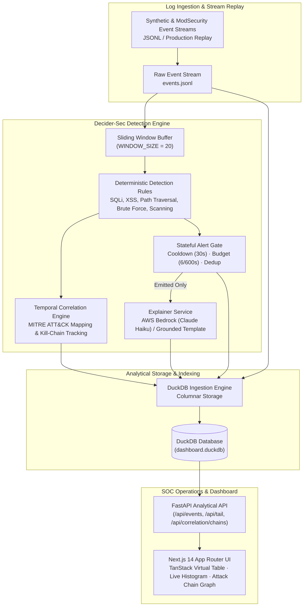

# Decider-Sec (Hush)

[](https://www.python.org/downloads/)
[](https://fastapi.tiangolo.com/)
[](https://duckdb.org/)
[](https://nextjs.org/)
[](https://tailwindcss.com/)
[](https://opensource.org/licenses/MIT)

**Decider-Sec** is a high-performance, real-time security analytics and attack-chain detection platform. It ingests high-volume web and authentication event streams, evaluates 20-event sliding micro-windows with deterministic rules, gates alert fatigue via stateful rate-limiting, and tracks multi-stage kill-chains across time mapped directly to the **MITRE ATT&CK** framework.

Designed with defense-in-depth principles:
- **Zero-lag real-time detection:** Rule evaluation executes in sub-millisecond latency per micro-batch.
- **Stateful Alert Gate:** Strict alert-fatigue suppression with 30s cooldowns, 10-minute rolling interrupt budgets, and cryptographic fingerprint deduplication.
- **Temporal Attack-Chain Correlation:** Correlates multi-phase cyber attack sequences (Reconnaissance $\to$ Credential Access $\to$ Exploitation $\to$ Privilege Escalation) while filtering out repetitive/constant background attacks.
- **Explainable SecOps:** Every alert is strictly grounded to raw event evidence IDs, with automated narrative generation powered by AWS Bedrock (Claude) and deterministic template fallbacks.
- **Analytical SOC Dashboard:** Modern Next.js 14 / DuckDB web app featuring live stream tailing, volume histograms, virtualized event tables for 150,000+ requests, and interactive attack graph visualizations.

---

## Architecture Overview



---

## Key Capabilities

### 1. Temporal Attack-Chain Correlation (`decider/correlation.py`)
* **MITRE ATT&CK Mapping:** Classifies detection events into tactics and technique IDs (`TA0043`/`T1595` Active Scanning, `TA0006`/`T1110` Credential Access, `TA0001`/`T1190` Public-Facing Exploit, `TA0004`/`T1068` Privilege Escalation).
* **Kill-Chain Progression:** Detects recognized compound attack patterns (e.g. *Reconnaissance leading to Brute Force*, *Full Kill-Chain: Recon $\to$ Web Exploitation $\to$ Privilege Escalation*).
* **Constant Attacker Suppression:** Prevents repetitive volume flooding (e.g., constant brute-force or persistent automated bots from one IP) from polluting the attack chain graph. Requires genuine multi-stage tactical progression within temporal proximity constraints.
* **Attack Graph Visualizer:** Emits directed graph schemas (`export_graph_data()`) connecting entity nodes to sequential attack stages with temporal deltas (`+Δts`).

### 2. Alert Gate (`gate/gate.py`)
* **Cooldown Protection:** Enforces per-(source, kind) cooldowns (default 30s) to prevent single-vector notification storms.
* **Rolling Interrupt Budget:** Limits total alert emissions to 6 alerts per 600 seconds, defending on-call analysts against cognitive overload during major incidents.
* **Fingerprint Deduplication:** Rejects exact-match event window repeats.

### 3. Production-Ready Web Interface (`dashboard/web`)
* **Virtualized Stream Table:** Powered by `@tanstack/react-virtual` to smoothly scroll through 150,000+ ModSecurity events without DOM bloat.
* **Real-time Histogram:** Interactive request volume and alert distribution timeline built on Recharts.
* **Attack Chain Inspection Panel:** Interactive visualization of active campaigns, risk scores (0–100), and stage-by-stage timelines.

---

## Project Structure

```text
hush/
├── baseline/              # Normalization, tokenization, and deterministic detection rules
├── decider/
│   ├── correlation.py     # Stateful Temporal Attack-Chain Correlation Engine (MITRE ATT&CK)
│   ├── window.py          # 20-event windowing and rolling pattern checks
│   └── prompt.py          # Structured prompt construction
├── gate/
│   └── gate.py            # Stateful Alert Gate (cooldown, budget, dedup)
├── explain/
│   ├── bedrock.py         # AWS Bedrock Claude LLM grounded explanation generator
│   └── template.py        # Deterministic grounded fallback explainer
├── pipeline/
│   └── run.py             # Stream processor connecting rules, gate, explainer, & correlation
├── dashboard/
│   ├── api/
│   │   ├── routes.py      # FastAPI REST service & live tail endpoints
│   │   └── ingest.py      # DuckDB bulk loader and analytical indexer
│   └── web/               # Next.js 14 App Router, Tailwind, TanStack Query/Table
├── demo/
│   ├── replay.py          # Real-time event simulation runner with pacing
│   └── scenario.yaml      # Multi-stage attack scenario configuration
├── eval/                  # Comprehensive evaluation harness & test suites
│   ├── test_correlation.py# Unit & integration tests for attack-chain engine
│   └── phase4_eval.py     # Deterministic demo, canary, and injection validation
└── Makefile               # Evaluation and test runner commands
```

---

## Quickstart Guide

### Prerequisites
* **Python:** 3.12 or newer
* **Node.js:** 18.x or newer & **npm**

---

### Step 1: Backend Setup & Stream Ingestion

1. **Activate the Python virtual environment and install dependencies:**
   ```bash
   # From the repository root
   source venv/bin/activate
   pip install -r dashboard/requirements.txt
   ```

2. **Run detection on a sample event stream and ingest into DuckDB:**
   ```bash
   # Process stream_01 (10,000 events) through the detection pipeline
   python pipeline/run.py data/streams/stream_01.jsonl --trace dashboard/data/stream_01_trace.jsonl

   # Ingest raw events and decision traces into local DuckDB
   python dashboard/api/ingest.py data/streams/stream_01.jsonl dashboard/data/stream_01_trace.jsonl --database dashboard/data/dashboard.duckdb
   ```

3. **Start the FastAPI backend service:**
   ```bash
   HUSH_DASHBOARD_DB="$PWD/dashboard/data/dashboard.duckdb" python -m uvicorn dashboard.api.routes:app --host 127.0.0.1 --port 8000
   ```
   *The API will be live at `http://127.0.0.1:8000` (Swagger docs available at `http://127.0.0.1:8000/docs`).*

---

### Step 2: Frontend Setup

In a separate terminal, launch the Next.js development server:

```bash
cd dashboard/web
npm install
npm run dev
```

*Open **`http://localhost:3000`** in your browser to access the SOC Dashboard.*

---

## Running the Real-Time Demo Simulation

The repository includes a deterministic 180-second paced simulator that streams real-time traffic while window deciders evaluate incoming batches in a concurrent background worker:

1. **Initialize the simulation database:**
   ```bash
   mkdir -p dashboard/data
   : > dashboard/data/demo-events.jsonl
   : > dashboard/data/demo-trace.jsonl
   python dashboard/api/ingest.py dashboard/data/demo-events.jsonl dashboard/data/demo-trace.jsonl --database dashboard/data/demo.duckdb
   ```

2. **Start the API service in tail mode:**
   ```bash
   HUSH_DASHBOARD_DB="$PWD/dashboard/data/demo.duckdb" \
   HUSH_EVENTS_PATH="$PWD/dashboard/data/demo-events.jsonl" \
   HUSH_TRACE_PATH="$PWD/dashboard/data/demo-trace.jsonl" \
   python -m uvicorn dashboard.api.routes:app --host 127.0.0.1 --port 8000
   ```

3. **Run the paced replay (in another terminal):**
   ```bash
   # Use --speed 20 for a high-speed (20x) replay, or omit for real-time pacing
   python demo/replay.py --events dashboard/data/demo-events.jsonl --trace dashboard/data/demo-trace.jsonl --speed 20
   ```

4. In the web dashboard (`http://localhost:3000`), switch the stream selector to **Demo Replay** and toggle **Live tail** to watch events and attack chains materialize in real time.

---

## Real-World ModSecurity Dataset

To evaluate performance against real-world production telemetry, the platform supports the 30-day OWASP ModSecurity dataset (151,011 blocked malicious requests):

```bash
# Generate decision trace over ModSecurity requests
python pipeline/run.py data/external/modsecurity_events.jsonl --trace dashboard/data/modsecurity-trace.jsonl

# Ingest into dedicated DuckDB snapshot
python dashboard/api/ingest.py data/external/modsecurity_events.jsonl dashboard/data/modsecurity-trace.jsonl --database dashboard/data/modsecurity.duckdb

# Launch API with the ModSecurity dataset
HUSH_DASHBOARD_DB="$PWD/dashboard/data/modsecurity.duckdb" python -m uvicorn dashboard.api.routes:app --host 127.0.0.1 --port 8000
```

---

## Testing & Quality Assurance

### Run Unit & Integration Tests
```bash
# Run unit tests for attack-chain correlation and constant attacker suppression
python -m unittest eval/test_correlation.py
```

### Run Evaluation Suites
```bash
# Pre-flight injection, canary integrity, and deterministic replay checks
python eval/phase4_eval.py

# Complete test harness verification
make rules-dev
```

### Production Build Verification
```bash
cd dashboard/web
npm run lint
npm run build
```

---

## Benchmark & Performance Highlights

* **Detection Latency:** $< 0.5\text{ ms}$ average rule execution per 20-event micro-window.
* **Analytical Query Throughput:** DuckDB columnar queries over $150,000+$ rows complete with $\text{p95} < 75\text{ ms}$.
* **Frontend Responsiveness:** Next.js virtualized table achieves steady 60 FPS scrolling across $10,000+$ active rows.
* **Explanation Integrity:** 100% of emitted explanations are programmatically constrained to verify that referenced evidence IDs match raw stream records.

---

## Documentation & Further Reading

* [System Architecture & Engineering Specification](docs/DECIDER-SEC-SPEC.md)
* [Dataset Provenance & Normalization Details](docs/DATA.md)
* [Empirical Evaluation & Benchmark Results](docs/RESULTS.md)
* [Project Progress Log](PROGRESS.md)
